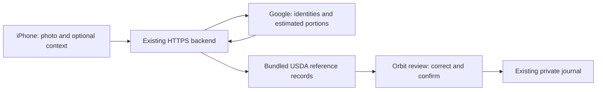

# Biteflow meal-photo analysis — validation and rollout

Updated 2026-10-13. Implementation is in the working tree. No release of this
feature has yet been deployed or uploaded to TestFlight. The latest verified
TestFlight release remains 1.0.0 (2), with Apple sign-in. The user authorized a new
TestFlight build only after the implementation and end-to-end checks work.

## What changed

The old MobileNetV2/ImageNet flow center-cropped photos to 224 pixels, mapped only
23 classes and returned one food suggestion with illustrative nutrition. It could
not describe a whole meal. Its endpoint remains compatible with installed clients.

The new mobile flow sends one photo, optionally a second angle and plate diameter,
to the hosted backend. A server-side Google model returns distinct components,
estimated grams, broad ranges, preparation, region descriptions and uncertainties.
It never supplies numeric nutrients or database identifiers. The server matches
against 13,225 actual USDA FoodData Central SR Legacy/FNDDS records and calculates
`per-100g value × grams / 100`, rounding half-up to one decimal place. Totals sum
those displayed item values. Unknown nutrients stay null and prevent a complete
nutrition total; no invented values or fabricated reference IDs fill gaps.

The Orbit review screen supports English/Hebrew, adding/removing/renaming foods,
reference search and alternatives, manual per-100g values, confirmation and instant
recalculation after editing grams. Each automatic reference is a suggested generic
recipe that requires confirmation. Confirmed foods save atomically into the
existing journal, with reference snapshots and retry identifiers. A retried save
returns the original entries; changing content with the same key conflicts.



The deployed architecture needs no developer Mac or home computer. This local
implementation still needs a backend deployment and a new mobile binary before
phone users receive it.

## Provider and cost decision

The user's later instruction prohibits paid AI APIs and production dependency on
their computer. An initial OpenAI proposal was removed accordingly. The existing
Google AI Studio project/key was reused, with its **Free tier** state verified in
the account UI. No billing or additional paid service was enabled.

On October 13 the account showed:

| Model | Requests/minute | Input tokens/minute | Requests/day |
|---|---:|---:|---:|
| Gemini 3.5 Flash Lite | 15 | 250,000 | 500 |
| Gemini 3.6 Flash | 5 | 250,000 | 20 |
| Gemini 3.8 Flash | 5 | 250,000 | 20 |

These are shared project limits, not per-user allowances or guarantees. Failed
attempts/retries can consume quota. Google resets daily quotas at midnight Pacific
time. The application returns a clear quota message and allows manual entry; it
never silently upgrades billing or switches to a paid provider.

A configured confirmation flag is an operator attestation, **not billing
protection**. Keeping the Google project without a linked billing account is the
actual zero-charge boundary. If someone enables billing later, the flag cannot
detect or prevent charges. Check the account tier before rollout and periodically.

The selected model is `gemini-3.5-flash-lite`: its final eight-image recheck
completed all cases, with 20/20 visible labels found and no extra predictions;
mean latency was 20.67 seconds. Meal-total MAE over seven food plates was 28 g
and 62.41 kcal. The earlier six failures out of eight remain in the report. These
small-sample results justify a limited beta, not an uptime/accuracy guarantee.
Both Mediterranean challenge calls and a real authenticated API/edit/save/retry
smoke check also completed. Challenges still expose sauce ambiguity and missing
regional nutrition references that must be corrected in review.

Measured comparison artifacts are in [the evaluation directory](../evaluations/meal_analysis/README.md).
Earlier live runs encountered invalid decoding schemas, service errors and quota
exhaustion; these are retained rather than hidden. An inlined structural schema
resolved the reproducible schema rejection; the full strict Pydantic contract
still validates types, finite bounds, field lengths, unique IDs and status.

Paid OpenAI/Anthropic/LogMeal services were not benchmarked, so this implementation
claims no superiority over them. A local Qwen3-VL 4B experiment completed on the
Mac but is not the production path. The old Windows computer remains untested;
[its benchmark instructions](LOCAL_VISION_BENCHMARK_HE.md) use the same licensed images.
Training a general food vision model from scratch is outside the evidence and
hardware available here.

## Privacy and reliability

- API keys are server-only; never use an `EXPO_PUBLIC_` variable for them. The local
  key is in ignored, owner-readable `.env`, not application code or an iOS bundle.
- Google receives photos and optional meal context, not account usernames, tokens,
  diary history or passwords. EXIF/GPS metadata is stripped before upload.
- Google's unpaid-service terms permit product improvement and human review. Both
  languages show this before analysis, with a terms link and a food-only notice.
  `store:false` does not override those terms.
- The backend handles images in memory and caches result JSON only: account/request
  scoped, ten-minute TTL, maximum 32 entries. Account deletion clears those entries.
  The mobile draft stores review data without a photo. Generated upload files are
  disposed after the request; the user's original library photo is untouched.
- Images must be JPEG/PNG/WebP, at most 8 MiB and 20 megapixels each, with minimum
  side 128 px. At most two views; resize to fit 2048 px while preserving aspect.
  Lighting/detail warnings are heuristics, not calibrated blur measurements.
- Existing bearer/cookie authentication and CSRF checks apply. Per-user rate limits,
  one image-processing slot and request/response bounds protect the small backend.
- Google requests use 45-second HTTP operation timeouts, at most one retry for
  transient 5xx/connect errors, and no retry on quota or read timeout. The client
  allows 120 seconds. These are not an unlimited availability guarantee.
- Session guards prevent an old account's in-flight analysis or draft save from
  being submitted under a newly signed-in account. Reviewer regressions cover it.

## Setup and deployment

Use [.env.analysis.example](../.env.analysis.example) for the backend variable names.
Set the key privately in the existing Render service's Environment page, merging
only these variables and preserving database/Apple settings:

```text
GEMINI_API_KEY=<private existing Google key>
FOODLOGGER_VISION_PROVIDER=gemini
FOODLOGGER_VISION_MODEL=<model validated by the release report>
FOODLOGGER_GEMINI_FREE_TIER_CONFIRMED=1
```

Do not add the key to EAS, Expo public environment, source control, mobile settings
or chat. `.env` is not automatically loaded by the normal backend CLI. Configure
process environment explicitly. The opt-in evaluation scripts read only the two
Google credential/confirmation entries from the local file.

1. Validate the final backend source and CI, including PostgreSQL and the free
   runtime. No schema migration is required for this feature.
2. Publish only the intended backend files to the existing repository/service;
   preserve unrelated work in the mobile checkout. Reuse the existing free Render
   web service and Supabase database. Do not create a second service/project.
3. Verify live public HTTPS registration, photo analysis, reference matching,
   reviewed multi-item save/retry, diary totals and account isolation with disposable
   test data. Clean up those test accounts. Check errors and resource use.
4. Only after those checks pass, build the existing EAS production profile, which
   points to `https://foodlogger-yfn4.onrender.com`, disables server override and
   increments the remote iOS build number. Verify the free build allowance first.
5. Verify the actual archive, upload the exact build ID to existing App Store
   Connect app `6821706586`, then verify processing/compliance and assignment to the
   existing requested tester groups. Do not initiate a public App Store release.
6. Physical iPhone camera/gallery, Hebrew layout and Apple sign-in still require
   device validation. An Expo JavaScript export is not a signed TestFlight binary.

## Limits to communicate honestly

A photo cannot measure exact mass, oil, density, hidden ingredients or recipe.
Ranges are conservative heuristics (at least 25–50%, 40% for composite dishes), not
calibrated confidence intervals. Optional plate size and second view are supported
but their accuracy benefit has not been measured. Textual regions are not pixel
segmentation. Additional crop/segmentation passes were not added without evidence
of improvement, especially under small free quotas.

Some regional dishes and detailed toppings lack exact USDA records. For example,
the photographed shakshuka and zaatar pita require manual/reference review rather
than fabricated recipe values. Reference search supports English and a limited
set of Hebrew aliases; the USDA source descriptions remain in English.

The eight-image convenience sample is too small for a production accuracy claim.
Its labels were reviewed by the implementation agent, not independently adjudicated.
No claim of exact weight, complete hidden-ingredient detection or medical accuracy
is made. The free Google and Render tiers have quota/cold-start limitations.

Result cache/rate limits are per process, not distributed. Journal idempotency is
backed by saved component rows; deleting every row of a group removes its retry
receipt. PostgreSQL tests and physical-device validation must be explicitly
reported as run or not run, never inferred from local SQLite tests.

## Sources

- [Google pricing](https://ai.google.dev/gemini-api/docs/pricing),
  [rate limits](https://ai.google.dev/gemini-api/docs/rate-limits),
  [billing](https://ai.google.dev/gemini-api/docs/billing),
  [unpaid-service terms](https://ai.google.dev/gemini-api/terms#unpaid-services).
- [Google image understanding](https://ai.google.dev/gemini-api/docs/image-understanding)
  and [structured output](https://ai.google.dev/gemini-api/docs/structured-output).
- [USDA downloads](https://fdc.nal.usda.gov/download-datasets/)
  and [data-use/provenance](https://fdc.nal.usda.gov/api-guide/).
- [Nutrition5k](https://github.com/google-research-datasets/Nutrition5k),
  [Qwen3-VL 4B](https://huggingface.co/Qwen/Qwen3-VL-4B-Instruct),
  [Ollama local runtime](https://docs.ollama.com/faq).
