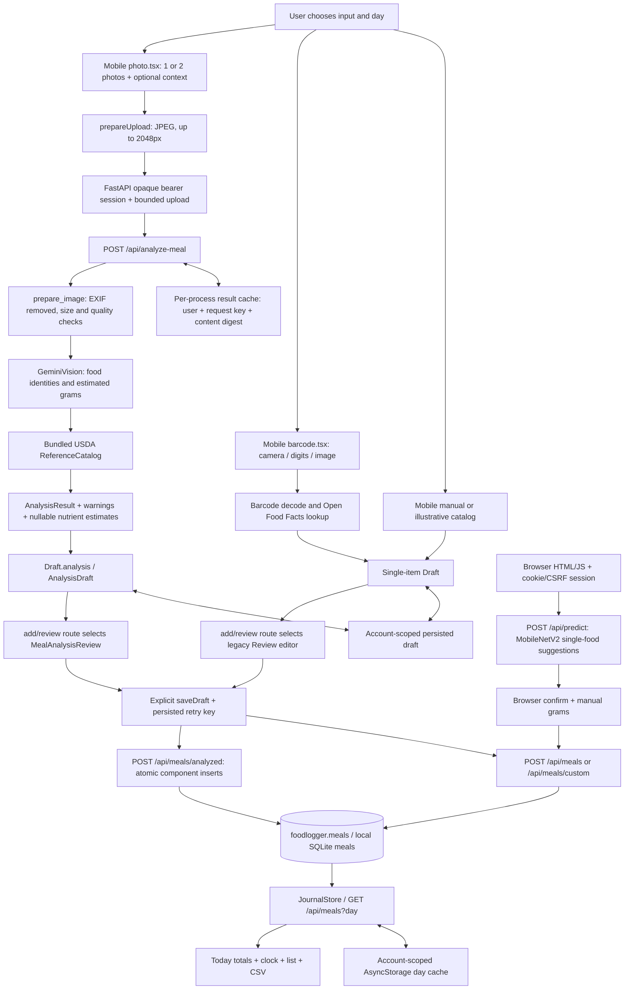

# BiteFlow P00 — Current-state audit

> This document preserves the P00 baseline at `9198d94`. Subsequent authorized work is reported separately in [P01](p01-checkpoint.md), [P02](p02-checkpoint.md), [P03](p03-checkpoint.md) [P04](p04-checkpoint.md) [P05](p05-checkpoint.md), [P06](p06-checkpoint.md) [P07](p07-checkpoint.md) and [P08](p08-checkpoint.md); those local results do not retroactively change this audit. P04–P07 are implemented locally, with full acceptance BLOCKED/unverified. P07 local tracking/trends and review fixes are verified; device/hosted gates remain open. P08 adds local insights/recommendations with full acceptance still blocked. Authorized P09 adds opt-in reminder decisions, derived logging streaks and mobile settings; see [P09 checkpoint](p09-checkpoint.md). P09 device/delivery acceptance remains BLOCKED; P10 is unopened.

Audit date: **2026-10-13, Asia/Jerusalem**. Scope: discovery, local baselines and a proposed design only. **P01 is not authorized or started.**

The repository has a substantial working logging foundation, including multi-food photo analysis. Against the full requested F01–F20 acceptance criteria, **5 features are partial and 15 are missing; none is fully verified against the new specification**. This does not mean the existing app is empty. Authentication, barcode lookup, manual/catalog logging, per-account drafts, daily journal, CSV export and atomic multi-component saves already exist and must be preserved.

Review [implementation-matrix.md](implementation-matrix.md) for every feature and [roadmap.md](roadmap.md) for proposed small PRs P01–P14. Evidence is in [evidence/](evidence/).

## 1. Sources, repository identity and evidence limits

Both supplied documents were read completely (361 and 252 lines). The requested `/mnt/data/BiteFlow_SPEC_EN(1).md` and `/mnt/data/BiteFlow_IMPLEMENTATION_PLAN_EN(1).md` do not exist on this Mac. The explicitly mentioned Downloads copies were available and are preserved unchanged under [requirements/](requirements/). Byte identity with the unavailable `/mnt/data` copies cannot be established.

| Source | SHA-256 |
|---|---|
| `requirements/BiteFlow_SPEC_EN.md` (36,537 bytes) | `44d179b3ccb322c74f954e7f0d7cdf69d081701eb93379de03e5295e0aa73cc8` |
| `requirements/BiteFlow_IMPLEMENTATION_PLAN_EN.md` (22,924 bytes) | `258cb4efa0f3933f60f2dd9e2dff5a4c2d4a107f52f7f3294c4ff5a6d385b2d5` |

The documents supply requirements, not authorization for their embedded deployment/handoff instructions. The current user's P00-only request controls execution. Historical repository plans and the cached prior conversation are context, not proof of implementation or permission to continue.

| Fact | Verified evidence |
|---|---|
| Actual workspace | `/Users/braude/Documents/projects/food-_loger` |
| Repository | `https://github.com/ophbra22/food-_loger.git`; local origin and connected GitHub `get_repo` agree; public, default branch `main` |
| Audited checkout | Branch `mobile-app`, commit `9198d94e003e1aefff2ccfd44e741eb21efa7d5e` |
| Identity | `mobile/app.config.ts:14` names Biteflow; `mobile/README.md` ties it to FoodLogger backend; bundle/package `io.github.ophbra22.foodlogger` |
| Remote HEAD observed | `886b8b494c8388ea5d4d32ee743857ce72075888`, via `git ls-remote origin HEAD refs/heads/mobile-app`; no remote `mobile-app` ref returned |
| Remote/local distinction | Backend `src`, tests, scripts, migrations, CI and `pyproject.toml` have no diff between that remote commit and audited HEAD. The mobile app is present locally but absent from remote HEAD. No push/fetch/merge was performed. |
| GitHub CI for audited HEAD | Connected combined-status query returned `statuses: []`. This is not proof of passing or failing Actions checks, nor an exhaustive check-run query. |
| Starting worktree | No tracked changes. Existing untracked `mobile/docs/screenshots/{apple-sign-in,stabilization,testflight}/`, `mobile/docs/validation/`, `output/`, `tmp/` were left untouched. |

Evidence labels used below: **fresh** = executed/read during this audit; **static** = inspected source behavior, not an end-to-end device claim; **historical** = existing report/screenshot, not independently repeated; **unverified** = access or validation missing. All source paths are relative to the workspace above, and line numbers refer to the audited commit.

## 2. Actual architecture and navigation

| Area | Actual implementation and anchors |
|---|---|
| Mobile | Expo `~57.0.27`, React Native `0.86.3`, React `19.2.3`, TypeScript `~6.0.3`; `mobile/package.json`. Expo Router stack in `mobile/src/app/_layout.tsx` and `mobile/src/app/(app)/_layout.tsx:7`. |
| Screens | Today `mobile/src/app/(app)/index.tsx:27`, Settings `settings.tsx`, detail/delete `meal/[id].tsx`, Add modal `add/index.tsx:29`, photo, barcode, catalog and review routes. Sign-in/register/recovery/Apple sign-in/account deletion exist. No Trends or goals/library/water/weight routes. |
| Look/localization | Dark pine Orbit theme in `mobile/src/theme/tokens.ts`; Hebrew/English dictionaries, direction and format helpers under `mobile/src/i18n/`. RTL switches with app reload; clock/numbers remain LTR. Historical `ios-he-home.png` and `ios-en-review.png` were visually inspected; they predate the new multi-food UI. No fresh mobile simulator or physical-device UI run. |
| DayDial | `mobile/src/components/DayDial.tsx:26` and `mobile/src/domain/dial.ts:8`: 24-hour ring, food dots, Add button. Dot sizes derive from calories. It is **not a goal-progress dial**. Macro bar on Today shows energy share (4/4/9), not target attainment. |
| Backend | FastAPI factory `src/foodlogger/app.py:165`, Pydantic schemas, Python package `foodlogger` 2.1.0; Python 3.11–3.12 supported. There is no Node backend, Supabase Edge Function or direct mobile Supabase client. |
| Browser | Separate HTML/CSS/JS client in `src/foodlogger/templates/index.html`, `static/app.js`, `static/style.css`; uses the legacy single-food classifier and same private journal. Mobile changes must retain this API consumer. |
| Persistence | `src/foodlogger/database.py:51`: local SQLite or PostgreSQL via psycopg. Supabase hosts a private `foodlogger` schema with a dedicated backend role. Custom auth, not Supabase Auth. |
| Build/hosting intent | `render.yaml` targets `main`, free Docker service, `Dockerfile.free`, external PostgreSQL, one instance. `mobile/eas.json` has development/preview/store profiles; production API URL is the existing Render service. No live hosting configuration or deployment was changed or independently audited. |

### Actual data flow



Gemini is the configured default (`src/foodlogger/vision.py:314`); a loopback-only Ollama experiment is allowed only outside production. There is no automatic paid fallback. These are code paths, not a claim about the currently deployed environment. The two mobile editors share a route and draft provider, but **do not yet implement one normalized item editor/MealDraft contract**.

### API inventory

`src/foodlogger/app.py` contains all routes; `mobile/src/api/endpoints.ts:38` mirrors mobile usage.

| Routes | Behavior / missing capability |
|---|---|
| `/api/auth/register`, `/login`, `/recover`, `/me`, `/logout`, `/account`; Apple `/challenge`, `/login`, `/link`, `/delete` | Account lifecycle, bearer/cookie sessions, recovery, deletion. |
| `GET /api/foods`, `/api/nutrition` | Public illustrative catalog/reference calculation, no account data. |
| `POST /api/predict` | Authenticated legacy classifier. |
| `GET /api/products/{barcode}`, `POST /api/barcode/scan` | OFF lookup and barcode-image decoding; **not label OCR**. |
| `GET /api/analysis/references`, `POST /api/analyze-meal` | USDA reference search, multi-food analysis returning review data; no journal write. |
| `POST /api/meals`, `/api/meals/custom`, `/api/meals/analyzed` | Confirmed journal entries. Key optional on legacy routes, mandatory on analyzed route. |
| `GET /api/meals?day`, `DELETE /api/meals/{id}`, `GET /api/export?day` | One-day journal, component deletion and CSV; **no PATCH**, range query or saved-recipe catalog. |

No goals, recipe CRUD, recents/favorites, copy, text/voice, OCR, water, weight, recommendations, weekly insights, health sync or budget-admin routes were found. Absence was checked against the complete route decorators, mobile endpoint definitions, route tree and SQL migrations, not inferred from README text.

## 3. Data contracts, nutrition and persistence

**Preserve these foundations:** `storage.py:14` derives stable owner/key IDs; `storage.py:55` and `:74` snapshot nutrition; `analysis_journal.py:15` resolves references on the server and inserts all components in one transaction. Tests exercise retries, concurrent saves, account isolation and rollback on a failed component insert. Missing optional product nutrients remain missing; incomplete analysis nutrients remain null and block save until completed.

**Actual schema:** the two migrations are `supabase/migrations/20261008142103_foodlogger_private_schema.sql` and `20261011194917_apple_sign_in.sql`. They define `schema_version`, `users`, `sessions`, `meals`, `apple_identities`, `apple_challenges`. There are no recipe/goal/health/AI-ledger tables. SQLite bootstraps/evolves its schema in `Journal`, `AuthStore` and `AppleAuth`; PostgreSQL checks version 1. The second SQL migration does not advance that version. Migration history must be inspected in a non-production copy before any new rollout.

Important contract gaps:

- `mobile/src/domain/drafts.ts:46` stores a single item plus optional `analysis`; `AnalysisDraft` (`domain/meal-analysis.ts:12`) holds multiple foods. Neither carries the specified timezone ID, occurred-at time, normalized food-specific portion, full provenance revision or common input adapter schema.
- Each analyzed component becomes a separate `meals` row. `details.group_id` relates rows, but the UI count and dial show components as meals; deletion is per row. No durable parent, independent request receipt or meal-level edit exists.
- `day` is a user-selected string; `created_at` is UTC insertion time, not consumption time. `domain/dial.ts:18` uses device-local insertion time if it matches the selected day, otherwise guessed meal-category times. A timezone change can move clock dots. Existing historical consumption times cannot be recovered exactly.
- All persisted core calories/protein/carbs/fat are NOT NULL. `schemas.py:38` and `analysis_journal.py:22` require complete core values. This rejects unknowns rather than turning them into zero, but cannot persist the new partial-data contract. Optional nutrients are JSON fields.
- `nutrition_reference.py:142` and `mobile/src/domain/meal-analysis.ts:43` round every item before summing. This explicitly differs from spec §3.2. Fresh synthetic probe: three 10g portions at 1.4 kcal/100g give 0.3 kcal now; unrounded sum is 0.42 and rounds once to 0.4. Existing tests intentionally enforce displayed-item reconciliation, so changing this requires contract/version decisions and new tests, not blind replacement.
- Legacy `nutrition.py:21` uses Python rounding; custom save uses three decimals inside details and one at top level; mobile single-item math is unrounded. One deterministic versioned calculation policy is needed for new writes without recomputing old logs.
- `products.py:155` handles OFF per-100g/ml, kcal/kJ and salt/sodium conversion. Sodium is currently in **grams**, whereas the requested model uses **mg**. `grams` also carries ml when `basis_unit=ml`; migrate meaning, not just field names.
- `data/foods.json` is explicitly illustrative. `data/usda_reference.json` contains 13,225 actual extract records with two archive URLs/checksums, public-domain attribution and provider IDs. `nutrition_reference.py:18` supplies a small Hebrew alias set; no verified Israeli official import or broad alias coverage exists.
- Catalog log details do not snapshot the original per-100 record/version. Existing totals are historical truth; provenance that was never saved must be marked legacy/unknown, not reconstructed as verified.
- Source selection is split by input route, not a unified specificity/verification resolver. A client-supplied barcode/source on custom logging is a user assertion, not proof of an independently fetched verified product.

## 4. Drafts, caches and failure behavior

`data/save-draft.ts:16` persists `attempted=true` before sending. Unchanged retries reuse the key; editing after an attempt generates a fresh key. `DraftProvider.tsx:95` adds only server-confirmed entries and clears the draft afterward. Session guards reject stale-account work. Offline use can show previously fetched days and retain an editable draft; **there is no background offline save queue** or AI-free repeat workflow.

The legacy browser submit handler (`src/foodlogger/static/app.js:218`) does not send an `Idempotency-Key`. Its busy flag prevents simultaneous clicks, but a lost response followed by resubmission can create a duplicate; this is a static risk, not a freshly reproduced browser failure. Extend its retry handling alongside the canonical receipt work. The mobile HTTP method union (`mobile/src/api/client.ts:10`) currently supports only GET/POST/DELETE; planned PUT/PATCH endpoints require a compatible client change and tests.

`data/journal-store.ts:70` loads cached days and refreshes them on focus/foreground via `useDay.ts`. Adds/deletes update local totals. Request counters reject older refreshes, but mutations do not advance those counters: an in-flight old day response could replace a just-updated day. This is a static race risk, not reproduced in this audit. A post-write revision/event policy should cover it before goals/trends are added.

`storage/kv.ts:21` casts parsed JSON without runtime schema/version checks. Writes/removals swallow storage failures. Therefore a failed persisted draft write can still be followed by a server save; crash/retry guarantees under disk-full conditions are unverified. Account cleanup blocks late writes on explicit sign-out/deletion. Session expiry clears credentials but does not invoke the full cache purge path; retention policy should be explicit.

Backend analysis cache (`meal_analysis.py:39`) is memory-only, owner/request scoped, content-digest checked, 600-second TTL, 32-entry cap. It stores result JSON, not image bytes. Request keys changing, expiry, restart and multiple workers can incur additional provider calls. Reference-search LRU (256 entries) contains public food matching data. OFF lookups have no persistent cache. Client day caches have no explicit TTL/size eviction policy. No insight/widget/health caches exist yet.

Photo capture has camera-denied/manual fallback, preparing/slow/error/no-food states and stale-owner guards. The client allows 120 seconds; the provider has bounded HTTP operation timeouts. Leaving the screen ignores stale responses, but there is no explicit cancellation control wired through the photo request to stop already-started provider work.

## 5. Security and privacy findings

Reviewed with the Supabase skill's auth/RLS checklist, adapted to this custom-auth architecture. No production database queries, migrations, account writes, uploads or deployment operations were performed.

Verified locally/static:

- Argon2 password hashes, hashed opaque session tokens, server-side expiry/revocation (`auth.py`). Native sessions use SecureStore `AFTER_FIRST_UNLOCK_THIS_DEVICE_ONLY` (`mobile/src/auth/session-store.ts:25`). Cookie sessions are HttpOnly/SameSite and production-secure; cookie writes require CSRF, bearer requests do not inherit cookie authority (`app.py:62`, `:265`).
- Authenticated owner IDs drive journal queries and delete predicates (`storage.py:140`, `:164`); requests cannot supply an owner ID. Fresh SQLite tests cover cross-account read/delete and analyzed save isolation. **PostgreSQL role behavior was not freshly executed.**
- SQL migrations revoke `PUBLIC`, `anon`, `authenticated`, `service_role` access to the private schema/tables and grant the dedicated server role. RLS policies for that role use `USING(true) WITH CHECK(true)`: **server-role isolation, not per-user database row isolation**. One missed owner predicate remains dangerous. Do not add `auth.uid()` policies that assume these custom user IDs are Supabase Auth identities.
- PostgreSQL validates remote TLS, uses parameterized statements, restricted search path and timeouts (`database.py:51–149`). Tests include TLS failure handling. Actual deployed role, grants, schema exposure and backups remain unverified.
- Apple proofs verify signature/issuer/audience/nonce; challenges are one-use. Refresh tokens are **Fernet encrypted**, not plaintext (`apple_auth.py:28`, `:121`). Rotation/backup recovery of `APPLE_TOKEN_ENCRYPTION_KEY` requires operational planning.
- Uploads are authenticated before buffering; bounded body, pixel, image and response sizes; EXIF stripped. Provider response bodies/keys are not intentionally logged by the new analysis endpoint. The legacy classifier logs a traceback on failure: revisit sensitive error retention before new telemetry.
- `.env` is ignored; only variable names were inventoried, never values. No provider secret is declared in Expo public config; only API URL/override are public. This is not a complete Git-history secret scan.
- Account deletion removes current meals/sessions/identity state transactionally and clears analysis result cache; mobile explicit deletion clears cache/drafts/temp CSV/images. Any new tables/queues must participate. Exported files already shared elsewhere cannot be revoked.
- Sensitive nutrition caches use account-scoped AsyncStorage, not application-level encryption; OS backup/protection, expiry retention and device-to-widget access need explicit decisions.

Google receives photos and optional context. Existing UI explains provider handling and links terms. `store:false` alone is not a retention guarantee. No audio, health records or new photos were sent during P00. No claim is made that existing upstream retention/billing policies were validated through the account UI.

## 6. AI provider, budget and quota evidence

Static configuration: server-only `GEMINI_API_KEY`, `FOODLOGGER_VISION_PROVIDER`, `FOODLOGGER_VISION_MODEL` (default `gemini-3.5-flash-lite`) and `FOODLOGGER_GEMINI_FREE_TIER_CONFIRMED`. The flag is an operator attestation, not a billing-account check. `vision.py:281` permits one retry for selected transient failures, no 429 retry, no read-timeout retry. Usage tokens are returned in analysis JSON but not durably booked in a project-wide ledger.

`app.py:515` limits analysis to 6 requests/user/minute; a semaphore limits concurrent image processing per process. `security.py:52` rate limits are memory-only. There is **no daily project reservation, photo reserve, per-feature allowance, durable cost accounting, cross-process limit or admin budget endpoint**. F14 is partial, not complete.

Historical `docs/MEAL_ANALYSIS.md` records an October 13 account observation: Flash Lite 15 RPM / 250,000 input TPM / 500 RPD; Flash 3.6 and 3.8 each 5 RPM / 250,000 input TPM / 20 RPD. These are **historical repository assertions**, not freshly verified limits. The specification's 500/350/150 split is a proposed policy and must not be confused with those assertions.

Fresh account-verification attempt: opened AI Studio Usage read-only, observed “No Cloud Projects Available” followed by “Network error, try again”; Rate Limit then navigated to `/520` with “An unknown error occurred.” No project was imported/created and no billing or key settings were changed. **Actual project/model quota and billing status remain BLOCKED on a working authorized account view identifying the backend's project.** Do not infer that the project is absent from these error screens.

Current [Google rate-limit documentation](https://ai.google.dev/gemini-api/docs/rate-limits) confirms that limits are project-scoped, model/tier dependent and RPD resets at midnight Pacific; it directs users to AI Studio for active allowances. This verifies general semantics, not this account's limits. P01 must record project, model, RPM/TPM/RPD, reset timezone, tier/billing state and retry/call accounting before live gateway activation. Unknown billing state should keep provider use disabled.

## 7. Fresh baseline results

Commands ran with `DATABASE_URL` and inherited `FOODLOGGER_*`, `GEMINI_*`, `APPLE_*`, `EXPO_*` removed, except explicitly set local flags. Normal CLI does not load `.env`. Python tests create disposable temporary fixtures; PostgreSQL tests were deliberately not pointed at any database. These checks do not mutate application/production data.

Environment: Python 3.11.14, Node 26.7.0, npm 11.19.0, Xcode 27.0 (27A266a). Installed package versions and command arrays/cwds/exits are recorded in [fixture-verification.json](evidence/fixture-verification.json), [commands.json](evidence/commands.json), [extra-commands.json](evidence/extra-commands.json).

| Command (workspace root unless stated) | Fresh result | Log |
|---|---|---|
| `.venv/bin/python -m pytest -q -ra -p no:cacheprovider` | **267 passed, 17 skipped**, 7.00s; exit 0 | [backend-tests](evidence/backend-tests.log) |
| `.venv/bin/ruff check --no-cache src tests scripts` | Pass, exit 0 | [backend-lint](evidence/backend-lint.log) |
| `.venv/bin/ruff format --check --no-cache src tests scripts` | Pass, exit 0 | [backend-format](evidence/backend-format.log) |
| `npm run typecheck` in `mobile` | Pass, exit 0 | [mobile-types](evidence/mobile-types.log) |
| `npm run lint -- --no-cache` in `mobile` | Pass, exit 0 | [mobile-lint](evidence/mobile-lint.log) |
| `npm test -- --runInBand --watch=false --no-cache` in `mobile` | **107 passed / 13 suites**, zero snapshots; exit 0. Watchman recrawl warning, no code failure. | [mobile-tests](evidence/mobile-tests.log) |
| `FOODLOGGER_RUN_BROWSER_TESTS=1 .venv/bin/python -m pytest -q -ra -p no:cacheprovider -m browser` | **5 passed, 279 deselected**, 14.47s; loopback server/temp SQLite/installed Chromium; exit 0 | [browser-tests](evidence/browser-tests.log) |
| `.venv/bin/python -m build --no-isolation --outdir /tmp/biteflow-p00-audit/python-dist /tmp/biteflow-p00-audit/source` | sdist + wheel built, exit 0, from `git archive HEAD` snapshot | [backend-build](evidence/backend-build.log) |
| `node_modules/.bin/expo export --platform all --output-dir /tmp/biteflow-p00-audit/mobile-export --max-workers 2` in `mobile` | iOS + Android Hermes bundles and web export built; exit 0. Offline/no telemetry, local API URL. | [mobile-export](evidence/mobile-export.log) |
| `.venv/bin/python docs/biteflow/evidence/probes.py` (initial run from identical `/tmp` copy) | Three observations reproduced, below; exit 0 | [probes](evidence/probes.log) |

The 17 initial skips were 5 browser (later run separately), 9 PostgreSQL, 2 opt-in LiteRT and 1 opt-in TensorFlow training smoke. LiteRT is not installed in this Mac environment. TensorFlow inference was run for the photo baseline; that is not a training-test pass. No Python static typechecker is configured. No Docker build, PostgreSQL migration rehearsal, native Xcode/Gradle archive, signing, EAS build, physical-device or new mobile screenshot validation was run. The JS export does **not** validate native health/widget modules or signing. No dependency install/update was required.

CI source `.github/workflows/ci.yml`: Python 3.11/3.12 checks, browser job, opt-in ML job, PostgreSQL 17/free-runtime Docker job exist. **There is no mobile typecheck/lint/Jest/export job.** Python dependency ranges are not locked; npm has a lockfile. Remote execution status must be checked at the future PR commit; local green checks do not establish deployed behavior.

### Fresh probes, no product changes

1. Analyzed save → delete all component rows → replay same key: HTTP **201 → 204 → 201**, day count 1. Deleted meal recreated because rows are the receipt (`analysis_journal.py:54`). Existing partial-deletion tests cover a different case.
2. Legacy save 100g → same key with 200g: **201 → 200**, returned 100g. This is existing first-write-wins behavior, unlike analyzed payload-conflict handling; clients must not assume uniform 409 semantics.
3. Item-rounding discrepancy described in §3 reproduced with synthetic nutrient values. These values are a numerical test, not food nutrition evidence.

## 8. Photo/OCR benchmark baseline and fixture plan

All **8/8** Nutrition5k manifest image SHA-256 hashes match. Manifest SHA: `f792451cee8754bf3083e0ad9574b7074d138876ac0973d749c9ddf31767dabd`. Seven food plates contain 20 visible reference components; one empty plate. Attribution, source URLs, CC BY 4.0 declarations and published portion/nutrient labels are retained in `evaluations/meal_analysis/manifest.json` and README. Visible labels were previously reviewed by an implementation agent, not independently adjudicated.

Fresh, local legacy baseline: from the archived source directory, `FOODLOGGER_WEIGHTS=/Users/braude/.keras/models/foodlogger_mobilenet_v2_1.0_224.h5 <workspace>/.venv/bin/python scripts/evaluate_meal_analysis.py --mode baseline --output /tmp/biteflow-p00-audit/photo-baseline.json`. Cached weights hash matches `classifier.py`'s expected `3e195a2857356cfc092cbbb460beb2a5bce279015d7792598b8d3d9e451902e3`; no download/provider call. The snapshot has no `.env`.

| Run | Completion | Detection TP/FP/FN | Recall | Latency | Portion / kcal error |
|---|---|---|---|---|---|
| **Fresh P00 legacy MobileNetV2** | 8/8 | 0/0/20; no accepted predictions | 0/20, 0%; precision undefined | Mean 543.25ms; P50 93ms; nearest-rank P95 3725ms; first request includes model load | Not applicable: no automatic mass/nutrients |
| Historical local Qwen experiment | 8/8 | 13/4/7 | 65% | Mean 13.80s | Historical matcher; not current pipeline |
| Historical Gemini 3.6 attempt | 2/8 | 3/1/1 on completed cases | End-to-end 15% | Mean completed 8.90s | Only 2 samples, failed cases excluded |
| Historical Flash Lite initial | 2/8 | 6/0/0 on completed cases | End-to-end 30% | Mean completed 44.83s | Only 2 samples |
| Historical Flash Lite recheck | 8/8 | 20/0/0 | 100% on this tiny sample only | Mean 20.67s | Meal-total MAE 28g / 62.4113 kcal, n=7 |

Fresh report: [photo-baseline.json](evidence/photo-baseline.json). Historical five report summaries were recalculated from saved result rows and match; this verifies report arithmetic and fixture identity, **not that historical provider calls occurred as described or that the current service matches them**. No fresh Gemini benchmark or paid call was made. Concurrent build jobs can affect fresh timing; this is not a comparable latency SLA or a measure of the default mobile Gemini pipeline.

Two additional Mediterranean fixture images/reports exist (`falafel-platter.jpg`, `shakshuka-pita.jpg`). They have source/license attribution but no weighed ground truth. Historical results expose sauce ambiguity and missing exact regional references. Do not include them in kcal MAE. No nutrition-label OCR dataset/pipeline exists; OCR accuracy is **NOT MEASURED**. No item-level portion MAE or calibrated confidence coverage is established by the stored meal-total metrics. Cost fields of zero in old reports are report assertions, not billing-ledger evidence.

Fixture work proposed for P01/P02/P06 (not created here):

- Preserve the eight images and failed reports; add independently adjudicated visible labels and weighed per-item intervals. Extend with Israeli dishes, sauces, occlusion, multiple plates, drinks, poor lighting, second angles and non-food; record consent/license and split before tuning.
- Add synthetic contract fixtures for null vs zero, NaN, g/ml, sodium mg, salt, kJ, tiny portions, mid-period goals, Sunday weeks, `Asia/Jerusalem` DST and travel. Use clearly synthetic values.
- Add two-account SQLite/PostgreSQL and disposable storage fixtures, lost-response/retry/delete/tombstone cases and 100 concurrent mocked gateway reservations. Never benchmark an external quota by exhausting it.
- For OCR curate permitted real Israeli labels with transcribed per-100/per-serving, units and uncertain fields; for Hebrew voice record consented phrases and denied-permission cases only after platform support is verified.
- Report sample counts, failures/abstentions, precision/recall including unavailable images, per-item and meal error separately, interval coverage, cold/warm P50/P95, requests including retries and measured usage. Agree improvement/regression thresholds before tuning.

## 9. Native feasibility

Generated `mobile/ios` and `mobile/android` exist locally but are ignored. Tracked source-of-truth is app config/plugins plus Expo code. No HealthKit/Health Connect/WidgetKit integration, App Group, notification/STT/OCR dependency or health sync mapping was found. Android explicitly blocks `RECORD_AUDIO`; the camera/image picker disable microphone permission. Existing Apple sign-in is unrelated to HealthKit.

| Capability | Feasible direction and required gate |
|---|---|
| Native baseline | SDK 57 / RN 0.86 pair matches the [versioned Expo reference](https://docs.expo.dev/versions/v57.0.0/). Existing dev-client/config-plugin architecture can host native modules; choose compatible dependencies only after a build spike. |
| iOS Health | Requires a HealthKit-capable native adapter, entitlement/usage descriptions and owned-record mapping; no current integration. The [Apple setup reference](https://developer.apple.com/documentation/healthkit/setting-up-healthkit) was reachable but body was not extractable here. Exact APIs/entitlements must be verified in P10; no device-validation claim. |
| Android Health | Requires platform availability/permissions and compatible adapter. [Android architecture](https://developer.android.com/health-and-fitness/health-connect/architecture) describes CRUD/change synchronization; that is not evidence of this app implementing it. P11 must validate supported OS/device, records and deduplication. |
| Widgets | [SDK 57 expo-widgets](https://docs.expo.dev/versions/v57.0.0/sdk/widgets/) documents real **iOS** widgets, App Group/config plugin and development-build requirement. It is not installed and does not establish Android support. Evaluate it before writing a bespoke iOS bridge; Android needs its own native widget path. Native home-screen tests and logout snapshot clearing are mandatory. |
| Voice/OCR | No current implementation. [Expo Speech](https://docs.expo.dev/versions/v57.0.0/sdk/speech/) is text-to-speech, not proof of transcription. Hebrew STT/OCR accuracy and offline availability must be measured on target devices; do not promise on-device support from package names. |

Existing `mobile/docs/MEAL_ANALYSIS_RELEASE.md` reports TestFlight build 1.0.0 (3), but explicitly does not pass the new photo/edit/save UI flow on a physical phone. Historical release records were not revalidated in Apple/Google stores during this audit.

## 10. Risk register and rollback ideas

Priorities express future implementation/release risk, not unproven exploit claims. No fixes below were implemented.

| ID / priority | Evidence and risk | Mitigation / gate | Rollback idea |
|---|---|---|---|
| R01 / high | `analysis_journal.py:54`, fresh probe: deleting all rows removes retry identity; retries resurrect data. | P01 durable owner/request receipt and deletion tombstone, payload digest, concurrent SQL tests. | Disable new writer; retain receipts/tombstones even when reverting UI. Never roll back by dropping them. |
| R02 / high | `storage.py`, required-core schema, rounded engine, sodium g and ml-in-grams fields. Silent reinterpretation/backfill would corrupt history. | Add versioned canonical snapshots; preserve old totals; explicit unknowns/legacy times; compare before/after sums. | Leave additive tables/columns; switch compatible readers, stop backfill, retain checkpoint and original snapshots. |
| R03 / high | `security.py:52`, `vision.py:281`: process-local throttles and unaccounted retries, no global budget. | P01 atomic per-project reservations, conservative crash handling, billable retry accounting; verify account allowance. | Server AI feature kill switch; manual/catalog continue. Do not rely on mobile flag alone. |
| R04 / high | Private-schema server-role RLS allows all rows; future omitted owner filter could expose another account. | Every API/repository method requires owner, two-account tests, actual role/grant checks on a copy. No direct client DB migration. | Disable affected endpoints/flags; preserve data and investigate, rotate credentials only through an approved response. |
| R05 / high | SQLite bootstrapping and two SQL migrations; version check only 1. Schema parity/installed-client compatibility uncertain. | P01 additive migration ledger and resumable backfill, old-client tests, backup/restore rehearsal on a copy. | Roll application back only to a schema-compatible version; no destructive down-migration. |
| R06 / high | `data/foods.json` illustrative; matcher generic recipes; historical challenge sauce error. | Preserve visible provenance; quality gate before AI expansion; never invent food/density values. | Switch resolver/analysis flag to previous compatible path; retain review/manual fallback and saved snapshots. |
| R07 / medium | Split editors/contract + component-level rows could diverge or duplicate systems. | P02 adapt existing DraftProvider and MealFoodEditor, canonical adapters, compatibility routes. | Turn off new editor/adapter while compatibility reads remain; no draft loss. |
| R08 / medium | `journal-store.ts:83` vs `:106`, `kv.ts:30`: mutation/refresh race and swallowed persistence failure. | Revision-based invalidation, storage error/outcome-unknown UX, account-switch/disk-full tests. | Revert optimistic path and refresh from server; retain drafts/receipts. |
| R09 / high | `day`, `created_at`, `dial.ts:18`: no consumed-time zone; copying/DST/history can shift. | Preserve assigned local date; never invent original consumed time; explicit ambiguous-time policy and flags. | Disable copy/history conversion; keep original dates and legacy display behavior. |
| R10 / medium | Sensitive AsyncStorage cache and Google photo handling; no new health privacy design. | Retention/backup review, minimal telemetry, protected widget snapshots, sign-out/account erasure tests. | Disable sync/widget/telemetry; clear only app-owned local artifacts; retain user logs. |
| R11 / high | Health/widget/streak/recommendation systems absent. Duplicate samples, prior-user exposure or unsafe allergy assumptions possible. | P08 filters; P10–P12 stable mappings, own-sample-only reconciliation, real-device validation, flags default off. | Stop queue/refresh and disconnect adapter; never delete other apps' samples. |
| R12 / medium | Israeli dataset/licensing and food-specific serving evidence absent. | P06 license/format/import dry-run review; approved existing sources/private products fallback. | Disable provider/import version; snapshots and alternative sources remain usable. |
| R13 / medium | No mobile CI; local mobile branch missing remotely; broad Python ranges. | P01 establish reviewed base/CI/lock strategy; no automatic push to Render's main. | Revert CI/config-only changes; retain tagged source manifest for each future build. |
| R14 / medium | `static/app.js:218`: browser saves omit request keys, so lost-response resubmission can duplicate a meal. | P01-C stable per-draft browser key, payload-edit policy and lost-response browser test. | Preserve existing API compatibility and server receipts; disable the new browser submission path if needed without erasing saved rows. |

## 11. Review decisions and blockers

P00 deliverables are prepared; its full exit gate is **BLOCKED**, not “verified in staging.”

1. **User review required:** accept or revise the feature inventory, compatibility design and P01–P14 roadmap before any product work. This is the current user's explicit gate.
2. **Quota verification:** a working read-only AI Studio account view for the backend's actual project is needed; capture model allowances, tier/billing state and reset semantics without exposing a key. Current error page prevented verification.
3. **Database validation:** a disposable PostgreSQL database/copy with representative schema and permitted fixture setup is needed to run role tests and future migration/rollback rehearsals. Existing tests drop the private schema on a `_test` database; they were not run against a real service. Live deployment state, backup/restore and grants remain unverified.
4. **Native validation:** compatible iOS/Android devices and capability/signing access are needed at their phase gates. No native health/widget implementation exists to validate now. Fresh mobile RTL/large-type/navigation screenshot coverage remains to be run.
5. **Quality:** current Gemini re-benchmark requires verified allowance and separately authorized external calls; independently adjudicated and weighed regional/label fixtures are needed for broader quality conclusions. No production requests are needed to finish reviewing these audit artifacts.
6. **Scope review:** the earlier local library/speed proposal includes one-tap saved meal behavior and rounding choices that differ from the supplied unified-confirmation/no-intermediate-rounding rules. This audit follows the new supplied spec; review that explicitly. Do not silently implement the older proposal.

## 12. P00 checkpoint

```text
Phase: P00 — Discovery, Baseline & Design Freeze
Status: BLOCKED (exit gate: user review, account quota verification and stated validation limits)
Feature IDs covered: F01–F20; 5 partial, 15 missing against the full new requirements
Repository baseline and paths inspected: 9198d94e003e1aefff2ccfd44e741eb21efa7d5e; mobile/src, src/foodlogger, tests, scripts, supabase/migrations, evaluations/meal_analysis, .github/workflows, app/build/env configuration and historical reports
Changed files / migrations: audit documentation, unchanged requirement copies and evidence under docs/biteflow only; see evidence/artifact-manifest.json for exact generated-file list; zero migrations or product-code changes
Functional behavior: existing auth, barcode/manual/catalog journal, draft recovery, daily totals, CSV and atomic analyzed saves supported by source and local tests; mobile device journey not freshly verified
Security / privacy checks: local owner-isolation/auth/CSRF/upload/TLS/deletion tests passed; SQL role policies inspected; live PostgreSQL grants/storage/backups unverified
Tests executed: backend 267 passed/17 skipped; browser separately 5 passed/279 deselected; mobile 107 passed/13 suites; Ruff lint/format and mobile typecheck/lint passed
Build / native-device validation: Python sdist/wheel and iOS/Android/web JS exports passed; native archives/signing/device tests NOT RUN
Photo/OCR/AI metrics when relevant: fresh legacy n=8, TP/FP/FN=0/0/20, recall 0%, precision undefined, no portion/kcal prediction; historical Gemini n=8 recheck retained, not rerun; OCR NOT MEASURED; no provider calls
Open defects and blockers: retry resurrection, rounding mismatch, missing canonical contracts/global AI gateway; provider UI unavailable, PostgreSQL/device validation and review outstanding
Rollback plan: P00 adds only review artifacts; remove only this audit's files if rejected, preserve pre-existing work. Future rollout/rollback gates are specified in roadmap.md
Next phase: P01 — Data Contracts, Security & Safe Migrations; prerequisites satisfied NO; not started
```
