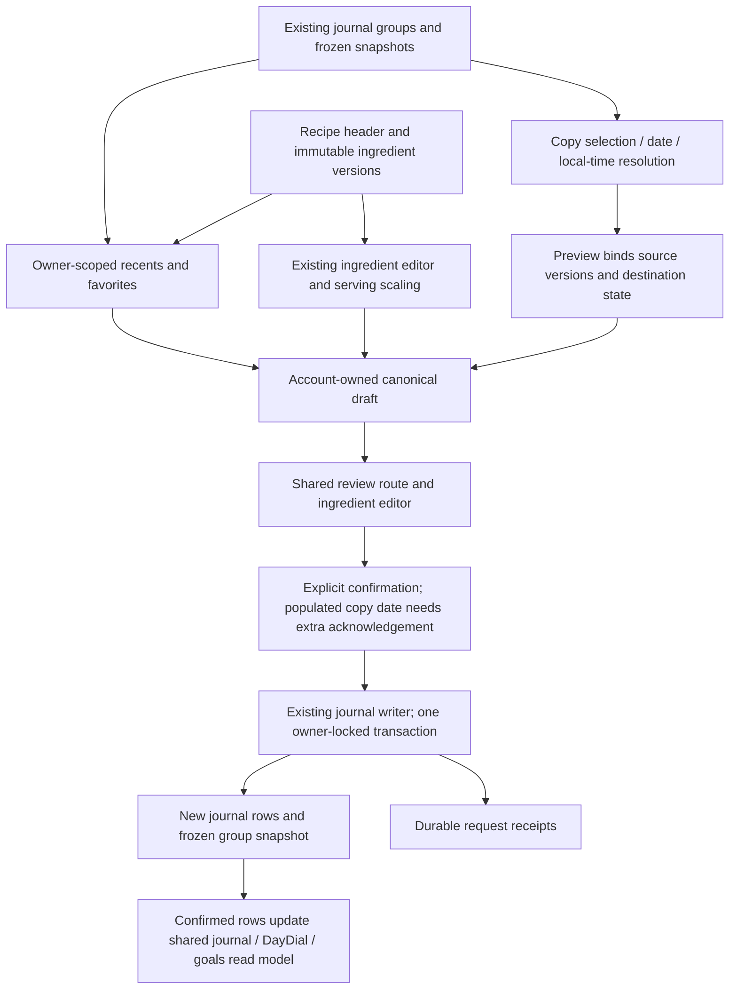

# P04 local operations and rollback

P04 is implemented locally but full acceptance is **BLOCKED**; this document authorizes no environment change. All executed database work used disposable `biteflow_p04_test` / `biteflow_p04_restore_test` on loopback PostgreSQL 16. No hosted migrations, deployments, pushes, merges or paid AI calls occurred.

## Additive schema and flags

Apply only after separately authorized environment validation, in repository migration order:

1. `20261014051354_p04_library.sql`: owner/type/source favorite links, unique composite key; no duplicate food catalog or nutrition data.
2. `20261014052225_p04_recipes.sql`: recipe headers, immutable versions and canonical item snapshots; `library_requests` stores durable create/duplicate/copy receipts. Header deletion is soft; account deletion cascades across all private data.
3. `20261014055032_p04_recipe_yield_decimal.sql`: change PostgreSQL serving yield from `REAL` to `NUMERIC`. The first schema rejected valid `0.01` because PostgreSQL's float32 value was below the numeric constraint. Existing REAL values are converted using PostgreSQL's text representation; original precision already lost before this migration cannot be reconstructed. New writes pass decimal strings, public JSON emits numbers. SQLite retains its existing double-precision REAL representation. No migration was run on a personal or hosted database.

All three files were created through `supabase migration new`. PostgreSQL tests apply them to a fresh private schema using the restricted `foodlogger_app` role for application operations. Public, anon, authenticated and service_role cannot access these tables. Recipe versions/items/receipts have SELECT/INSERT/DELETE grants, no UPDATE; headers alone need UPDATE. RLS grants access to the backend role, not per-user Supabase Auth. **Every owner predicate is still required** because the backend role serves multiple accounts.

| Flag | Default | Effect / prerequisites |
|---|---|---|
| `FOODLOGGER_LIBRARY_ENABLED` | false | Recents, favorite links and recipe reads; canonical backfill must be ready |
| `FOODLOGGER_RECIPE_WRITES` | false | Recipe mutations; requires library access and recipe schema |
| `FOODLOGGER_COPY_ENABLED` | false | Source selection, copy preview and confirmation; writes additionally require canonical writer, partial/tiny-compatible storage and receipt schema |

Existing P01/P02 compatibility/AI gates and P03 goals flag are unchanged. No AI route is needed for repeat, recipe or copy. Copying never mutates goal revisions. Copy confirmation has a 512 KiB body limit and at most 20 selected groups; each group retains the existing 15-item and normalized 0.0001–2000 g/ml bounds. Larger days display a selection-limit message and must be reviewed in subsets. No silent truncation occurs.

## Actual data flow

Recents/favorites and recipe-list caches are account-scoped. Offline selection can prepare an unsaved draft; server acknowledgement is required before the journal changes. Recipe forms and copy drafts persist before dispatch with a stable retry identity. Copy receipts replay only while all resulting groups are live and unchanged. A source/destination version change after preview returns conflict; users must prepare a new preview. Unknown local times require explicit input; zone round-tripping rejects nonexistent times and requires an explicit fold choice for repeated times. Known wall time is preserved in the destination timezone, including travel.

Original canonical portions retain unit, quantity, conversion ID and estimation status through unchanged/scaled library, copy and recipe forms. Generated recurring fractional quantities preserve their precision through storage and save; keyboard precision constraints remain for changed manual text. A user explicitly changing basis still has the separately carried P02 provenance limitation.

## Safe rollback procedure

1. Turn the P04 flags off in the affected, separately authorized environment. Keep P02-compatible readers, null/tiny quantities and the canonical journal enabled as appropriate for that environment. Refreshed clients show unavailable states; offline caches remain visibly stale until refreshed.
2. Reconcile in-flight operations by their retry receipts/current versions. Disabling a flag does not undo a transaction already committed. Do not retry an uncertain copy under a new key without checking the journal.
3. Preserve all new tables, saved snapshots, version history, receipts and tombstones. **Do not DROP the tables or downcast NUMERIC to REAL.** Narrowing the yield representation reintroduces a valid-input failure and loses precision. Older application code can ignore these additive tables.
4. If code rollback is necessary, revert local phase commits in reverse order on a dedicated recovery branch, after reviewing unrelated changes. Baseline is `714bbf3`; `p04-checkpoint.md` lists logical commits. Do not reset or clean the original checkout. Rollback has not been executed against a hosted environment.
5. For data recovery, restore a separately authorized complete private-schema backup to an isolated database first, validate owner grants, favorites, recipe versions/items, source/copy snapshots and parent/child receipts, and test retry/delete behavior. Reconcile client drafts/caches against restored server state before reopening writes. A point-in-time restore can lose later commits and cannot be treated as an ordinary request replay.

## Rehearsal performed

`evidence/p04/restore-library.py` created synthetic source meals, a recipe with two versions, a favorite and a confirmed copy; dumped the private schema; restored it to another disposable database; and read through the restricted application role. Exact version/item/favorite/snapshot equality passed. Retrying the restored copy returned the same result; deleting it and retrying returned conflict. The restore database was dropped afterward. The final rehearsal includes the NUMERIC migration.

This establishes local recovery evidence only. Hosted backups, PostgreSQL version/tzdata differences, CI, staging traffic, real provider policy and physical-device behavior remain open gates.
