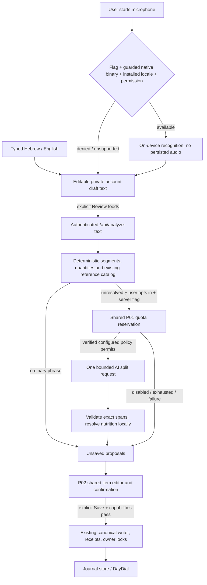

# P05 operations, contracts and rollback

P05 local implementation only. This document does not authorize production activation, a provider call, push, merge, deployment or P06. See [checkpoint](p05-checkpoint.md) and [speech feasibility](p05-speech-feasibility.md).

## Data flow

AI is off by default and was mocked throughout this work. The fallback proposes text partitions/search names only. It cannot supply nutrition, quantities or reference IDs. Source selection remains a visible estimated proposal requiring confirmation. Unknown household/volume amounts stay blank; no half-pita gram conversion, volume density or new Israeli nutrition source is invented. Those conversions are P06.

## Contracts and compatibility

`POST /api/analyze-text` accepts text (1–2000 characters), `language` (`he`/`en`), existing date/category fields, `input_method` (`text`/`voice`) and `allow_ai` (false by default). AI opt-in requires the existing stable idempotency header. The authenticated endpoint is limited to 30 requests/minute per owner. It does not write intake records. Gateway reservations/accounting are the only server writes on an enabled ambiguous-AI path.

The conservative input bound is checked under the same locked policy as the reservation; a policy shrink cannot reserve fewer tokens than that bound.

Response `schema_version:2` contains 1–15 unsaved `foods`, warnings and `ai_status`. Original parsed quantity/unit is preserved even when a normalized amount is unknown. `draft` is a canonical `MealDraft` only when all normalized quantities exist; otherwise it is null. This avoids weakening P01/P02's positive-portion contract. Mobile validates the proposal envelope and adapts it to the existing version-2 shared review. No second nutrition editor, total calculator or intake store exists.

Mobile adds `text`/`voice` draft origins and bounded `inputText`. Existing origins, partial nutrients, tiny portions, confirmation and receipt retry behavior remain. Transcripts are private account draft text; they use the same account storage and erasure lifecycle. They are not audio files and are not logged as telemetry. A request cancellation or account replacement ignores late responses; native cancellation ignores late transcripts.

**Database:** no schema change, new table, migration or down migration is required. Existing P01–P04 local database regression was executed against a newly created, loopback-only disposable PostgreSQL 16 database. Production/hosted databases were not accessed. Existing migrations/backup and restore instructions remain applicable.

## Flags and prerequisites

| Control | Default / effect |
|---|---|
| `FOODLOGGER_TEXT_AI_ENABLED` | false; independently disables the text ambiguity provider path |
| P01 `FOODLOGGER_AI_ENABLED` and verified gateway policy | required in addition to text AI flag; no guessed quotas or paid fallback |
| `EXPO_PUBLIC_VOICE_ENABLED` | unset/0; hides voice method and rejects native bridge; build-time value, not a runtime kill switch |
| Existing canonical/partial/tiny write capabilities | still checked by shared save; P05 does not bypass the P02 compatibility gate |

Deterministic text/manual entry remains available when AI or speech is unavailable. Enabling voice requires a newly generated/rebuilt native app with the pinned speech bridge and checksum guard. A JS-only update cannot add the native module/permissions. Old iOS binaries without the safeguard marker fail closed. The camera/image-picker permission settings and the custom Android manifest mod were verified together in both flag states, because plugin ordering/stale removal markers can otherwise erase microphone permission.

Physical-device evidence is required before voice activation: actual installed HE/EN models, permission denial/revocation, interruptions/background, headset routing, stop/cancel cleanup, no retained raw audio or cloud traffic, transcript error/correction measurements, real account switching, full confirm/save and accessibility. No real recordings or privacy-network measurements were collected here. The feature remains flagged off. Android binary compilation is additionally blocked by the host's missing Java runtime.

## Recovery / rollback

1. Disable `FOODLOGGER_TEXT_AI_ENABLED` to stop new ambiguity dispatches; keep deterministic parsing. Do not erase existing gateway reservations or receipts. Already dispatched reservations must settle conservatively through the existing P01 policy.
2. For voice, build/review a client with `EXPO_PUBLIC_VOICE_ENABLED=0` (or roll back to the last approved client). This is a build-time switch; changing a server variable cannot disable an already installed client. Preserve text/manual entry and private drafts. No cloud-STT fallback is enabled.
3. For code rollback, revert P05 fixes and C/B/A commits in reverse dependency order after preserving unreviewed drafts. No journal rows require deletion or conversion; previously saved canonical text/voice meals remain ordinary canonical records. Older client draft validators may reject new text/voice drafts, so export/reconcile unsaved descriptions before a client downgrade; do not silently delete them.
4. To recover dependencies, reinstall from the pinned lock and rerun Expo prebuild. The local plugin validates SHA-256 before patching the two vendor Swift files. Unexpected source/version changes must be reviewed, not bypassed. Generated native folders and dependency edits are not committed as product source.
5. Keep the local branch/worktree for review. Local disposable test services and Metro are stopped after evidence is archived. No production rollback was executed or simulated as production evidence.

[Speech feasibility](p05-speech-feasibility.md) records the platform restrictions and existing dependency audit risk (67 advisories in baseline and current locks). Neither compilation nor mocked tests closes the device/privacy gates.
