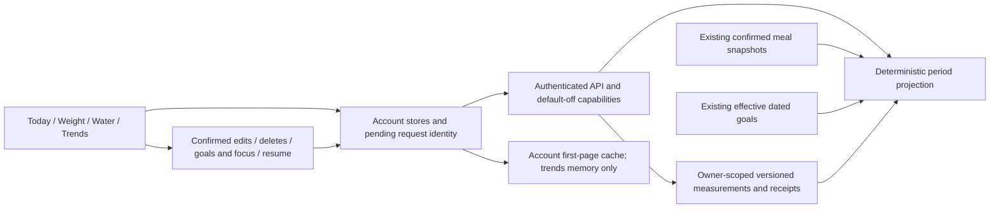

# P07 checkpoint — local implementation verified; full acceptance BLOCKED

**2026-10-15. P07 only. P08 has not started and requires explicit approval.** User approved P06 with all open gates and the label-draft rollback caveat. Those remain visible in [open gates](p07-open-gates.md). P07-A/B/C and five independent-review fixes are committed locally on `codex/biteflow-p07`, based on `fca475d4b9feaba2545d2c7e65b83a5692d918d0`.

Full phase acceptance is **BLOCKED**, not declared complete: Android native compilation fails for missing Java; physical-device/full native E2E and hosted CI/staging remain unverified. Local automated results are green. No production modifications, hosted migrations, live AI calls, push, merge or deployment occurred. No paid provider operation was performed. All three P07 feature flags default off.

## 1. Implemented features

- **P07-A:** authenticated owner-scoped water/weight create/read/edit/delete; canonical ml/kg; measured instant, assigned local date, explicit offset and IANA zone; version conflicts; immutable request hashes/receipts and tombstones; stable retries after restart; source/external-ID deduplication at repository level; account erasure; bounded/paginated JSON read/export contract. Imported health sources cannot be spoofed through manual HTTP writes. Meal beverage logging never creates water.
- **P07-B:** Sunday-week/calendar-month UI with exact dates and preceding equal-length comparison; deterministic period read model over confirmed meal snapshots, dated goals and measurements; logged-day, measured-date and water-logged-date denominators; missing/partial data and provenance preserved; daily latest weight; adherence with explicit eligible/logged counts. Historical edits/deletes and effective-goal changes invalidate the same data. No AI is used.
- **P07-C:** Today hydration target/progress; +150/+250/+500 ml, custom amount, history, edit/delete and explicit timestamp/zone; weight latest/change/target; kg/lb and ml/US fl oz display conversions; week/month metric selection; separately labeled calorie/weight axes, layer toggles, dated goal marks, gaps and day drill-down; EN/HE strings, accessible controls and textual values; optimistic feedback, error rollback, persisted retry identity, account isolation and focus/resume refresh.

Health synchronization, reminders, widgets and insights are later phases. P07 provides source contracts only. There is no optional “logging complete” feature and no new bulk export/share UI. Those decisions and costs are in [ledger](evidence/p07/ledger.md).

## 2. Components and architecture

Backend additions: `src/foodlogger/tracking.py`, `trends.py`, `data/tracking.sql`; routes/capabilities in `app.py`; SQLite initialization in `auth.py`; default-off controls in `security.py`. The existing journal remains the intake authority; P03 revisions remain the goal authority. No canonical nutrition contract or provider quota is changed.

Mobile additions: `mobile/src/domain/{tracking,trends}.ts`, `data/{tracking-store,trends-store,useTracking}.ts`, `components/{TrackingPanel,TrackingScreen,WaterToday,TrendsChart}.tsx`, and `src/app/(app)/{water,weight,trends}.tsx`. Existing journal/goal invalidation, Home/GoalDashboard and navigation gain the new read models. EN/HE dictionaries and synthetic fixtures/tests are included. See [every changed path](evidence/p07/changed-files.txt) and [per-commit implementation files](evidence/p07/commits.txt).

Global latest/previous/delta are measurement-time ordered. After a confirmed write followed by read failure, these summaries become unavailable until refreshed; a bounded day's history cannot establish global order. Complete water pages reconcile by record identity. Incomplete aggregates become unavailable rather than inventing a total. Retry responses may return a later edited record and are handled accordingly.

## 3. Database changes and recovery

One additive migration: `supabase/migrations/20261015112017_p07_tracking.sql`, generated with the Supabase CLI naming workflow. Two private tables: `tracking_entries`, `tracking_receipts`. Includes owner/date and measurement-time indexes, source/request uniqueness, foreign-key erasure and version/tombstone constraints. No destructive migration ran.

The project uses custom opaque sessions and a private server role, not user Supabase JWTs. Public/client roles (`PUBLIC`, `anon`, `authenticated`, `service_role`) cannot access these tables. Server repository queries predicate owner; direct-role tests execute on disposable PostgreSQL16. Hosted configuration is unverified.

[Operations and rollback](p07-operations.md) defines flags, persistence, retention/export boundaries and [non-destructive write revocation](rollback-p07.sql). Local rehearsal actually preserved reads, denied new writes, restored grants, and restored a pg_dump into a separate disposable database. Never drop receipts/history to downgrade. Retain a compatible client while pending measurements or P06 label drafts exist.

## 4. Actual test commands and results

Commands below run from the worktree root unless a directory is shown. The [safe runner](evidence/p07/run.py) clears inherited provider/application/database variables, sets offline/CI/loopback values, and supplies only the explicitly owned test database to `postgres*` commands. Python HTTP transports are blocked/mocked by test fixtures. [commands.jsonl](evidence/p07/commands.jsonl) records exact argument arrays, cwd, exit code and duration; full logs include intermediate failures.

| Check / command | Actual result | Evidence |
|---|---|---|
| `.venv/bin/python -m pytest -q -rs` with disposable PG16 DSN | **467 passed, 9 skipped, 0 failed** (476 collected); 444 regular/API/domain tests + 23 PostgreSQL integrations | `postgres-final.log` |
| `.venv/bin/python -m pytest tests/test_postgres.py -q` | **23 passed, 0 failed/skipped**; included in full count, not additional unique passes | `postgres-a.log` |
| `.venv/bin/python -m pytest -m browser -q -rs`, opt-in flag | **6 passed, 470 deselected, 0 failed/skipped**; these six were skipped in full run | `browser-reviewed.log` |
| `.venv/bin/python -m pytest -m integration -q -rs` without model opt-in | **3 skipped, 473 deselected**; no model execution claimed | `optional-ml-status.log` |
| `mobile: npm test -- --runInBand` | **263 passed / 53 suites**, 0 failed/skipped | `mobile-reviewed.log` |
| `mobile: npm run typecheck` | **PASS**, exit0 | `types-reviewed.log` |
| `mobile: npm run lint` | **PASS**, exit0, no warnings | `lint-reviewed.log` |
| `.venv/bin/ruff check src tests scripts` | **PASS** | `ruff-final.log` |
| `.venv/bin/ruff format --check src tests scripts` | **PASS**, 87 files already formatted | `ruff-format-final.log` |
| `.venv/bin/python -m build --no-isolation` | **PASS**, wheel and sdist; tracking SQL packaged | `package-candidate.log` |
| `mobile: npx --no-install expo export --platform all --output-dir ../.superpowers/sdd/roadmap/export-reviewed` | **PASS**, iOS/Android Hermes and web bundles; not Android native binary | `export-reviewed.log` |
| `mobile: xcodebuild -workspace ios/Biteflow.xcworkspace -scheme Biteflow -configuration Debug -sdk iphonesimulator -destination 'generic/platform=iOS Simulator' -derivedDataPath ../.superpowers/sdd/roadmap/ios-build -disableAutomaticPackageResolution CODE_SIGNING_ALLOWED=NO build` | **PASS**, actual unsigned Debug simulator build, 261.82s; upstream warnings retained | `ios-native-build.log.gz` |
| `mobile/android: ./gradlew assembleDebug --offline` | **FAIL**, exit1: Java Runtime unavailable | `android-native-build.log` |
| `.venv/bin/python docs/biteflow/evidence/p07/preview.py` against local Metro fixture entry | **2/2 EN/HE component scenarios PASS**, 0 runtime errors; synthetic browser preview, not native E2E | `preview-reviewed.log`, four PNGs |
| `.venv/bin/python docs/biteflow/evidence/p07/rehearse.py` against owned DB | **PASS**, write-disable/read-preserve/re-enable/backup/restore assertions | `postgres-recovery-final.log` |
| `.venv/bin/python docs/biteflow/evidence/p07/measure.py` | **PASS**, 12,000 synthetic meals, 20 runs, 30 current+30 prior dates; median2.998ms/max3.347ms, owner/date indexes used | `query-performance.log` |
| `git diff --check fca475d -- . ":(exclude)docs/biteflow/evidence/p07/**"` | **PASS** for source/docs; raw archived logs retain original whitespace | `final-verification.txt` |

Unique executed Python tests: **473 passed / 476 collected**, with **3 NOT RUN** optional model smoke tests. Do not add overlapping focused runs. Three skips are `test_lite_classifier.py:193`, `:217`, `test_ml_integration.py:15`. Hosted CI/Python version matrix, release signing/device builds, actual physical journeys, optional ML inference, Docker free-runtime image build/smoke, fresh dependency registry audit and live providers are **NOT RUN**. No separate Python static typechecker is configured/run. UI previews cannot establish VoiceOver/TalkBack or real keyboard behavior.

## 5. Regression evidence

All P01–P06 automated tests remain in the full runs. P06 baseline was439 backend +6 browser and226 mobile; P07 adds28 backend cases and37 mobile cases. No tests were removed or skipped to make the counts pass. Existing TextResume router mocks were extended for newly used navigation hooks. Auth/owner isolation, partial/tiny quantities, canonical contracts, atomic confirmation/save/retry, goals, recipes/repeats/copy, text/voice and label/private-product tests pass with mocks. This verifies the tested behaviors, not untested physical workflows or original recognition quality.

The final review fix did not change backend/native dependencies; final Python run and JS exports were still repeated. Native simulator compilation used the unchanged generated native project; later TypeScript fixes are verified by the final Hermes export, not a claim that physical native tests ran.

## 6. Review findings and fixes

A fresh-context independent reviewer inspected the full candidate range and reproduced **five Important, zero Critical, zero Minor** issues. All five were fixed in one pass with actual failing-then-passing regressions: (1) retry double totals/duplicate identity, including edit/delete and date moves; (2) permanently blocked queue after another-device edit; (3) stale weight summary after successful mutation/read failure; (4) missing dedicated-screen focus/resume refresh; (5) malformed nested trend targets causing a render crash. [Review record](evidence/p07/review.md) gives candidate lines, reproduction and disposition. No second review or implied independent reapproval is claimed.

Intermediate failures are preserved: initial TDD missing routes/components; route generation/type/lint/mock issues corrected; a disposable restore DB retained role grants and caused23 PG fixture setup errors, fixed by removing only that owned restore DB before rerun; review cache-eviction/read race fixed by awaited eviction; AppState test cleanup corrected. Final lint's import-order warning was removed. The Android Java failure remains unresolved.

## 7. Acceptance criteria

“PASS” is limited to the named executed local evidence. A BLOCKED required criterion prevents full P07 acceptance.

| Criterion | Status | Supporting evidence / limit |
|---|---|---|
| Weight/hydration owner CRUD, chronology, units, versions and idempotence | **PASS locally** | 17 tracking cases, 23 PG integration cases including P07 role test; mobile unit/retry cases |
| 250+500=750; delete250→500; no automatic meal-water duplication | **PASS locally** | API test, EN/HE component journeys, browser previews |
| Empty days do not lower averages; three logged/four missing uses3 | **PASS locally** | `test_three_logged_days_four_gaps_and_effective_targets`; null gaps and denominator UI |
| Mid-period goal change preserves prior achievement; comparable prior dates | **PASS locally** | trends fixtures with effective revisions and equal-length interval |
| Multiple weights/day uses latest measurement; measured-date average; no invented points | **PASS locally** | `test_daily_latest_weight_measured_date_average_and_water`, gap/chart tests |
| Edits/deletes propagate; Today/Trends reconciliation and offline failure behavior | **PASS locally** | backend historical recomputation, store invalidation, five review regression groups including resume/restart |
| Clearly labeled calorie/weight dual axes and toggle layers | **PASS locally** | chart component tests and inspected EN/HE screenshots; native device rendering unverified |
| Date/offset/IANA/DST/leap/unit boundaries | **PASS locally** | tracking validation and trends calendar parameter tests, display round trips; real-device travel behavior unverified |
| Authenticated bounded JSON export and account erase; additive recovery | **PASS locally** | owner erasure/role tests, documented pagination/export policy, actual permission+dump restore |
| E2E-10 hydration, E2E-11 weight, E2E-12 incomplete-week complete native journeys | **BLOCKED** | API/domain/component portions pass; no full physical route execution |
| E2E-19 security | **PASS local API/PG roles; BLOCKED hosted** | two-owner/server-role tests and account-cache tests; hosted roles/storage reconciliation unverified |
| E2E-20 full localization/accessibility, physical iOS/Android | **BLOCKED** | bilingual component/preview/unit evidence only; VoiceOver/TalkBack, dynamic type, keyboard, device RTL NOT RUN |
| Native packaging parity and hosted CI/staging | **BLOCKED** | iOS Debug simulator build passes; Android fails missing Java; hosted matrix NOT RUN |
| Health/widgets/reminders integrations | **NOT IN P07** | stored dedup contracts tested; later phases explicitly not implemented |

## 8. Remaining blockers and carried gates

**Blocking P08 without an explicit scope/gate decision:** full P07 acceptance remains BLOCKED as above; no automatic phase advance. No known unfixed Important code finding remains from this review. User may explicitly carry external gates into the next local phase; that is not release approval.

**Blocking production:** device/hosted/native gates; provider quota/policy proof; original OCR/photo/speech quality; dependency advisory triage; basis-correction provenance; earlier full E2Es and saved-meal edit UI; legacy-data readiness; retention/export signoff. **Deferred non-blocking:** exact10% macro advisory boundary, P06 source-label localization, native speech patch maintenance, large-workflow limits and explicit retry of lost in-memory AI results. [Open-gates table](p07-open-gates.md) classifies every carried item, including publication licensing and both downgrade caveats. None is closed by a compile or mocked test.

## 9. Local commits and rollback

1. `c66fb0bc0f9b4e166f3a8770f4e91a0b0bb6c6a0` — private versioned tracking repositories/API/schema/tests.
2. `981ffb8f7892c24dd9785488f3cac98b04be6664` — deterministic dated analytics/tests.
3. `ce7fb3f31683e6e62cd8a4102235ed7543216bad` — mobile views/stores/i18n/tests and initial operations/checkpoint.
4. `758918cb849ee9782060de55808563a3d53027cf` — five review fixes and regressions.
5. Final documentation commit — this report, ledger, review, exact logs, screenshots, gates and changed-path inventory; its hash is returned in the handoff (a commit cannot contain its own hash).

For code-only rollback, first preserve backups and resolve pending operations, then create a rollback branch and revert the four implementation commits in reverse order (`758918c`, `ce7fb3f`, `981ffb8`, `c66fb0b`). Retain schema/receipts and use flags/permission revocation rather than table drops. Do not execute a reset, force-push or destructive down migration. P06 reader compatibility must remain for label drafts (older readers reject label origin and longer input).

Only the owned test PostgreSQL container and Metro process are cleaned up. Starting Docker Desktop auto-resumed unrelated existing local restart-policy containers; those were not queried/modified by this task and are left alone. Worktree and branch are preserved; final tracked/untracked status should contain only the pre-existing `.venv` symlink. Final clean-worktree verification is recorded in the handoff after the documentation commit. **Stop here; await P08 review and explicit approval.**
