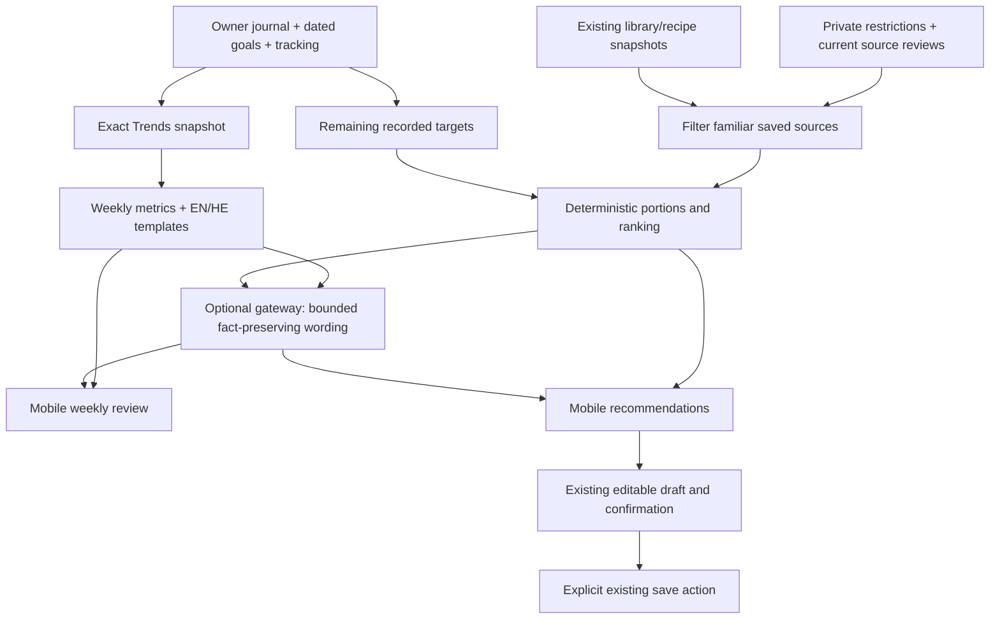

# P08 checkpoint — 2026-10-15

**P08 local implementation and all four Important review fixes are verified. Full P08 acceptance remains BLOCKED by external/native gates. P09 has not started.**

## Scope and features

The user approved P07 with all open gates and rollback caveats carried forward, authorizing P08 only. Work is local on `codex/biteflow-p08` in the existing attached worktree `/Users/braude/.codex/worktrees/biteflow-p01/food-_loger`, based on `55f6409d93f7f2bd10ad365652205ad3301aa93c`. Primary checkout is preserved. No push, merge, deploy, production or hosted-database operation, paid operation or live AI request was made.

- **P08-A / F12:** weekly EN/HE summaries reuse the exact Trends snapshot; logged-day averages, calorie/protein achievement, category distribution and preceding-week comparison retain missingness and denominators. Bounded owner/week/data+goal/language cache; corrections change the revision. No unsupported breakfast claim.
- **P08-B / F13:** optional private allergy/diet preferences, privacy clearing and source-version ingredient review. Restrictions filter familiar saved recipes, favorites and recent meals before deterministic portion ranking. Return up to four viable choices, with two or more only when available. Explicit unknown allergy/nutrient states, incomplete-goal warnings, source provenance and user-review uncertainty. Selection opens the shared editable confirmation flow and does not save.
- **P08-C / F14:** optional gateway-accounted phrasing selects approved variants from bounded structured facts. Returned numbers, candidate IDs, revision and sentence IDs must match exactly. No unrestricted medical/nutrition prose. Timeout, quota, disabled/unavailable policy or invalid output leaves deterministic content. No automatic retry. All exercised provider transports were mocks.
- Mobile entry points on Today, dedicated Week in Review/recommendation/restriction screens, bilingual copy, runtime nested response validation, bounded memory-only cache and owner/late-response protection. No P09 notification, streak or general preferences functionality.

## Files and architecture

Backend: `src/foodlogger/insights.py`, `recommendations.py`, `wording.py`; minimal integration in `app.py`, `auth.py`, `security.py`, `trends.py`; `data/recommendations.sql`. Existing canonical math, journal, dated goals, recipes/library, authentication and gateway remain authoritative.

Mobile: three routes under `mobile/src/app/(app)/`; `AdvicePanel.tsx`, `AdviceScreen.tsx`, `FoodRestrictions.tsx`; `data/advice-store.ts`, `useAdvice.ts`, journal invalidation; `domain/advice.ts`, `i18n/advice.ts`, API endpoint validators; dedicated API-generated synthetic contract fixture and tests. No native dependency or canonical draft schema changes. New recommendations use existing recipe/repeat draft origins.

Database: two additive private owner-scoped tables, preferences and ingredient reviews, with optimistic versions and deletion cascades. `supabase/migrations/20261015122803_p08_recommendations.sql` preserves existing schema. Public/anon/authenticated/service_role cannot read/write; the existing private server role has RLS-protected access, with API owner predicates/locks. No destructive migration. [Operations and rollback](p08-operations.md) describe flags, data flow, bounds, privacy and restore; [permission rollback](rollback-p08.sql) preserves every row. Exact changed paths are archived with evidence.

## Actual verification

Every command, exit code, duration and raw output is in [evidence](evidence/p08/README.md). Intermediate red/failing runs are retained; they are not reported as passes. Commands below run from repository root unless the area says mobile, through the sanitized `docs/biteflow/evidence/p08/run.py` wrapper.

| Actual command / area | Final result | Evidence |
|---|---|---|
| `.venv/bin/python -m pytest -q -rs` / root, disposable PG16 configured | **495 passed, 9 skipped, 0 failed**, 504 collected; includes24 PostgreSQL integration cases | `postgres-reviewed.log` |
| `.venv/bin/python -m pytest -m browser -q -rs` / root, browser opt-in | **6 passed, 0 skipped, 498 deselected** | `browser-final.log` |
| `npm test -- --runInBand` / mobile | **293 passed, 0 failed/skipped, 58 suites** | `mobile-final.log` |
| `npm run typecheck` / mobile | **PASS**, exit0 | `types-final.log` |
| `npm run lint` / mobile | **PASS**,0 errors/0 warnings | `lint-final.log` |
| `.venv/bin/ruff check src tests scripts` | **PASS** | `ruff-reviewed.log` |
| `.venv/bin/ruff format --check src tests scripts` | **PASS**,93 files | `format-reviewed.log` |
| `.venv/bin/python -m build --no-isolation --outdir .superpowers/sdd/roadmap/dist-final` | **PASS**, wheel+sdist; new modules/SQL included | `package-final.log`, `wheel-contents.txt` |
| `npx --no-install expo export --platform all --output-dir ../.superpowers/sdd/roadmap/export-final` / mobile | **PASS**, iOS/Android Hermes and web | `export-final.log`, `build-artifacts.json` |
| `xcodebuild -workspace ios/Biteflow.xcworkspace -scheme Biteflow -configuration Debug -sdk iphonesimulator -destination 'generic/platform=iOS Simulator' -derivedDataPath ../.superpowers/sdd/roadmap/ios-build -disableAutomaticPackageResolution CODE_SIGNING_ALLOWED=NO build` / mobile | **PASS**, unsigned Debug simulator compile; candidate native graph unchanged by review fixes | `ios-native-c.log`, complete output compressed in `.log.gz` |
| `./gradlew assembleDebug --offline` / mobile/android | **FAIL/BLOCKED**, missing Java runtime; no APK | `android-native-c.log` |
| `.venv/bin/python docs/biteflow/evidence/p08/rehearse.py` / owned PG16 | **PASS**, write pause preserves both tables, denies writes, reenables and restores backup | `postgres-recovery-reviewed.log` |
| `.venv/bin/python docs/biteflow/evidence/p08/preview.py` / owned loopback Metro | **PASS**,4 EN/HE component previews, zero runtime errors; unsaved200g handoff | `preview-ready.log`, four PNGs |

Unique executed Python tests: **501 passed /504 collected**, not the sum of overlapping focused runs. The remaining **3 NOT RUN** opt-in model tests are LiteRT at `test_lite_classifier.py:193,217` and TensorFlow at `test_ml_integration.py:15`. The six browser skips in the main run were executed successfully in the separate browser command. New P08 coverage adds28 backend cases (27 service/API/cache/wording cases plus one PG-role case) and30 mobile cases relative to P07. No tests remain failing in the executed automated suites.

All backend/mobile tests use mocked/off providers and local fixtures; HTTPX real network transports are blocked by the test fixture. PostgreSQL was an owned local PG16 container bound to loopback. The Android native failure is retained, not converted into a passing build claim. Native iOS compilation preceded TypeScript-only review fixes; final Hermes exports verify corrected JS for both platforms. EN/HE screenshots are synthetic previews, not physical-device E2E.

No separate Python static typechecker is configured. Hosted CI/Python matrix, real providers, physical devices, signed release builds, optional ML inference, free-runtime image smoke and fresh dependency registry audit are NOT RUN. No new photo/label benchmark or accuracy claim.

## Regression and review

Existing P01–P07 tests remain in the full backend/browser/mobile runs. Owner isolation/authentication, atomic saves and retries, partial/tiny quantities, canonical calculations, dated goals, library/recipes/copy, text/voice/label/private products, tracking and trends retain their tests. No test was removed or skipped to make P08 pass. Mocked passes do not establish physical-device or live-source acceptance.

A fresh-context independent reviewer found **four Important, zero Critical and one Minor** findings. All four Important findings were fixed in one pass, with actual RED→GREEN tests: privacy-clear stale/ABA review resurrection; negative remaining-target rejection; stale foreground recommendation selection; silent replacement of existing/uncertain drafts. Source review now requires the monotonic preference revision; selection rereads the authoritative deterministic revision; existing drafts offer resume and block replacement, including during an awaited read. [Review record](evidence/p08/review.md) includes candidate lines, reproductions, dispositions and every declined-to-judge ruling. No second review or implied independent reapproval is claimed. The Minor restrictions-editor AppState refresh is deferred; focus/manual Refresh remains and CAS/selection revalidation protect writes and selection. Early development fixes already verified: Pydantic review normalization recursion; invalid source sort column; incomplete schema readiness; stale cache writes after owner erasure. Corrected temporary formatting, route generation, shared test-fixture mutation, test typing, React Compiler ref-write lint, preview-entry discovery and rehearsal tuple issues are visible in logs. Android missing-Java blocker remains.

## Acceptance

| P08 criterion | Status | Executed evidence / limit |
|---|---|---|
| Summary numbers equal Trends, three logged/four unlogged denominator | PASS locally | `test_week_matches_trends_three_logged_days_and_no_breakfast_claim`; API-generated mobile fixtures |
| EN/HE averages, achievement, meal distribution, prior period, missing cautions | PASS locally | API/template and component/browser preview checks; native layout/accessibility unverified |
| Historical correction/goal changes invalidate summary; owner/week cache isolation | PASS locally | revision tests, cache expiry/copy/erasure fence, mobile correction/account-close tests |
| Restrictions filter before ranking; 500 kcal/40 g; unknown ingredients excluded for restrictions | PASS locally | recommendation/API/PG tests; ingredient-review assertions are user supplied, not independent safety verification |
| No safe candidates, unknown allergies, partial nutrition/incomplete goals | PASS locally | deterministic service and response-validator tests, explicit UI states |
| Choices use saved provenance, editable portions, shared confirmation and no auto-save | PASS locally | API unchanged journal check; domain and AdviceScreen handoff tests; browser200g unsaved preview |
| No-AI usability, exhausted quota/429/timeout/mismatch fallback and usage | PASS locally | `test_wording.py`; inherited100-concurrent-reservation SQLite/PG tests also pass |
| Private preferences/source reviews, owner roles/cascade, additive rollback/restore | PASS locally | PostgreSQL role tests + owned PG16 rehearsal; hosted verification remains BLOCKED |
| E2E-12/13 complete physical native journeys | BLOCKED | API/domain/component portions pass; physical iOS/Android execution NOT RUN |
| E2E-14 real project policy/quotas and device fallback | BLOCKED external; PASS mocked accounting/fallback | Provider account policy not inspected or assumed;100-request configured mock limit tests pass |
| E2E-19 hosted DB/storage and device account lifecycle | BLOCKED hosted/native; PASS local API/roles/cache | Local evidence does not replace hosted role/migration/reconciliation |
| Native release parity and hosted CI/staging | BLOCKED | Android Java absent; device/signing/hosted NOT RUN; JS exports pass |

A required BLOCKED criterion prevents a claim of complete P08 acceptance.

## Remaining issues and gates

**Blocking P09 without explicit approval:** full external/native acceptance above; user must explicitly carry these gates if authorizing the next local phase. No unfixed Important/Critical finding remains from this review; the one Minor refresh issue is explicitly deferred. **Blocking production release:** all items in [carried gates](p08-open-gates.md), including actual provider policies, hosted CI/staging/backup, device validation, basis-correction provenance, photo/label held-out protocol, speech quality, dependency triage, earlier full E2Es and retention/export signoff. **Deferred non-blocking:** exact10% advisory warning threshold, earlier source-label localization, native speech patch maintenance, bounded large-source workflows and lost AI cache explicit-retry behavior. No inherited gate was silently closed.

## Commits and rollback

1. `35443eaee53955a2daac632fec6ba31a04747271` — deterministic weekly insights/cache/tests.
2. `eb941afeb72fc5606328cf09f10fdba272cbf882` — restrictions, source reviews, ranking, additive private schema/tests.
3. `20be1d300e18fb84d1574ca250cb447996dbe579` — optional bounded gateway wording, fallback, erasure fences/readiness tests.
4. `146ee99e32e569614646e9038b077b692a53976d` — mobile consumers, UI/contracts/tests and operations/rollback docs.
5. `be15f77b5ba9294078710b084e5650e50d7b5266` — four review fixes and regression tests.
6. Final documentation/evidence commit — this report, exact logs, screenshots, review/ledger, gates and path inventory. Its hash is returned in the handoff because a commit cannot embed its own hash.

For rollback, disable wording first; disable recommendations/writes if integrity is in doubt; retain restrictions/reviews and backups. On a new rollback branch, revert implementation commits in reverse order (`be15f77`, `146ee99`, `20be1d3`, `eb941af`, `35443ea`), preserving additive schema and any in-flight owner operations. Never drop tables or reset history. P06 label drafts require a compatible reader; P07 pending measurement receipts must be reconciled or retained with a compatible client. P08 does not change those caveats. Local permission pause and full schema restore are rehearsed; hosted rollback remains unverified.

Owned test PostgreSQL and Metro were stopped; disposable DSN, synthetic preview entry and this plan’s archived scratch are removed. The attached worktree and local branch are preserved; final status is checked after the documentation commit, with only the existing `.venv` symlink expected. **Stop here. P09 requires explicit user review and approval.**
