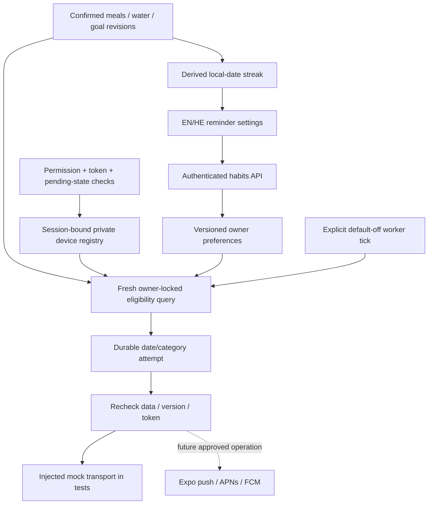

# P09 — reminder decisions, delivery and logging streaks

Scope: approved roadmap P09-A/B, F15. Base a16d75d. P10 is not started. All development uses local databases and mock AI/push transports. Feature flags remain off by default.

## Reuse and contracts

Confirmed `meals.day` and `meal_type` remain authoritative, including legacy confirmed entries. No draft, water entry, goal success, or fabricated nutrition value becomes a logged day. Duplicate dates count once. Today and future filtering uses the requesting device's valid IANA timezone. Historical journal dates never move when the device travels. Current streak is the consecutive run ending today or yesterday; it breaks at the next local midnight after a missed day. Longest streak and total logged days exclude future dates. No persisted streak counter needs migration or reconciliation.

`GET /api/habits?timezone_id=...` returns derived streak and versioned preferences; `PUT /api/habits/preferences` requires expected_version. Five independently opt-in HH:MM slots: breakfast/lunch/dinner, water, evening review. Defaults all off, 22:00–07:00 quiet hours, unmuted. Equal quiet endpoints suppress all day; paired null disables quiet hours. Water requires a dated positive goal and confirmed water total below target. Evening review requires at least one confirmed log.

Private additive tables: `reminder_preferences`, `reminder_devices`, `reminder_attempts`. SQLite setup follows existing initialization; PostgreSQL uses CLI-created `20261015132704_p09_habits.sql`. Existing custom opaque authentication remains. All public/anon/authenticated/service_role access is denied; server-role RLS follows existing private-schema architecture with explicit owner predicates and locks. Tokens are server-only private data, never included in GET responses or logs. Devices reference session hashes with ON DELETE CASCADE; recovery, online logout and deletion revoke them. Maximum five session/device registrations per owner. Rotation replaces the same session's token; another owner cannot take an existing token. App preferences do not store credentials.

## Delivery policy and operational boundary

Expo SDK57 documentation confirms token registration makes an Expo request, and background tasks/OS delivery are not guaranteed. We therefore do not schedule recurring local alerts. See [Expo notifications](https://docs.expo.dev/versions/v57.0.0/sdk/notifications/) and [push transport semantics](https://docs.expo.dev/push-notifications/sending-notifications/).

An explicitly invoked one-shot `python -m foodlogger.reminder_delivery` worker is inert unless **both** `FOODLOGGER_HABITS_ENABLED=1` and `FOODLOGGER_PUSH_DELIVERY_ENABLED=1`. No cron, service, cloud deployment, or automatic API-process worker is installed. A future reviewed scheduler would invoke it once per minute, with a singleton operational schedule plus DB deduplication protecting overlapping ticks. `FOODLOGGER_EXPO_ACCESS_TOKEN` is optional server-only runtime configuration for enhanced Expo push security; no token was provided or used. Runtime DSN comes from existing DATABASE_URL/FOODLOGGER_DB, never a client.

Every dispatch reads current preferences, sessions, confirmed meal categories, and water/goal state under the established owner lock. No eligibility cache. Every registered, unexpired-session device must be ready and have a server-recorded check within **15 minutes**; otherwise suppress the owner. Pick the most recently checked device, one destination per owner/category/day. Stale devices can suppress reminders on other devices until refreshed or signed out. The mobile lifecycle refreshes on foreground, native token rotation, confirmed logs, water/goal changes, and every five foreground minutes. Pending/unknown draft storage or measurement receipts pause eligibility. Foreground alerts are suppressed, and only owned scheduled/presented alerts are canceled/dismissed.

A scheduled wall-clock slot is eligible for five minutes, without late catch-up. Spring DST gaps skip nonexistent times; repeated fall hours share a date/category receipt. A 20-hour same-category cooldown also limits travel-induced duplicates. Device timezone mismatch pauses until the user explicitly saves the current timezone. Locale and quiet hours are saved preferences.

A durable attempt is committed before transport. Eligibility is queried again, version/token checked, and a decision taking over five seconds is suppressed. Send holds the owner lock and uses a five-second HTTP timeout. A crash, uncertain timeout, transport 429, rejected/malformed ticket, or commit failure never triggers an automatic resend. This deliberately favors missing a reminder over duplicates. `sent` means the sender returned/Expo accepted a ticket, **not** device delivery. `DeviceNotRegistered` ticket responses revoke the token. Generic EN/HE message reveals no meal/nutrition values; `ttl=0` avoids queued redelivery. The provider/OS still controls actual delivery timing.

**Limitations requiring production validation:** delivery cannot be recalled after transport accepts it; an offline sign-out/permission change or unsynced entry cannot instantly revoke the server lease (up to 15 minutes). Closed apps beyond the lease may miss reminders. Push receipt polling/retention and operational monitoring need a reviewed release policy; a successful ticket is not a delivery receipt. Actual project/APNs/FCM credentials, owner consent/privacy for sending tokens to Expo, scheduler scale/runtime, token lifecycle, quiet-hour behavior after network delays, signed release and physical-device checks are unverified. Keep server delivery and `EXPO_PUBLIC_REMINDERS_ENABLED` off. These limitations are disclosed in the UI where relevant and do not count as passed acceptance.

## Rollback

1. Pause all external worker invocations; set push delivery and habits flags to 0. Keep client reminders flag off in subsequent builds.
2. Active clients clear only owned pending/presented notifications; offline installed clients need later reconciliation. Already handed-off pushes cannot be recalled.
3. Preserve all three additive tables, preferences and attempt identities. Optional local/staging `rollback-p09.sql` revokes inserts/updates while retaining reads/deletion. No destructive down migration.
4. Return application code to P08 base only after verifying compatibility. Streak is derived; logs and nutrition contracts are unchanged. Session/account erasure remains supported through FK cascades.
5. Restore grants and compatible P09 code only after approval; preserve attempts to avoid duplicate delivery. Rehearse backup/restore in a disposable database, never on production during this phase.

All earlier P06 label-draft, P07 pending-measurement and P08 restriction/review rollback caveats still apply. No HealthKit, Health Connect, widgets or P10 work is included.

## Independent review fixes

Online session revocation now takes the same owner lock as dispatch; concurrent account erasure is idempotent. A notification cannot newly enter transport after successful online logout has returned. Existing in-flight accepted notifications remain unrecallable.

The private device row now includes a unique hashed installation proof and monotonic generation. A random proof is persisted in device-only SecureStore, separate from account logout; no health/account content is stored there. A new notification lifecycle increments and persists its generation before registration. A signed-in new account can rebind that same installation without the old credential, while different proofs and earlier in-flight generations are rejected. Both owner parents lock in sorted order. The proof is sent only to the authenticated backend, stored hashed, never returned or logged. SecureStore failure/corruption fails closed; reinstall/lost-identity recovery and physical account switching remain explicit gates. This P09 migration was never deployed; its final schema is additive relative to the approved P08 base.

Slot eligibility validates local wall-clock existence through UTC round trip, including the last four minutes of a spring gap. Immediately after the final database query, dispatch rechecks the full decision deadline, quiet/slot/date boundary and earliest lease/session expiry across every registered device. Slow decisions consume the attempt without sending.
