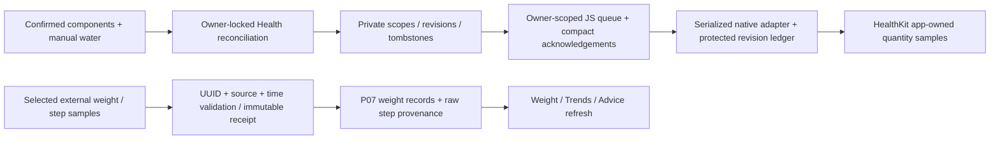

# P10 checkpoint — local implementation; full acceptance BLOCKED

Date: 2026-10-15. Branch: `codex/biteflow-p10`. Base: `0bcfbaaa7f92b211d49f2bfb42f0180baa3ce2c3`. Final implementation commit: `f754bed` (checkpoint/evidence documentation is committed afterward). User authorized **local P10 only**, explicitly carrying prior gates. P11 has not started. Neither this checkpoint nor successful local tests establish production readiness.

## 1. Implemented features

- Apple-only local Expo/HealthKit module and config plugin; default-off native/server flags; permission/status/settings UI in English and Hebrew. Independent opt-in for nutrition writes, water writes, weight reads and steps reads. Read authorization remains unknown; partial/denied permission does not gate ordinary logging.
- Export known kcal/protein/carbs/fat quantities and manual water with original time/zone. Preserve stable owner scope, sample identity and monotonic revision; keep deletion tombstones. Unknown nutrients are omitted, not zero-filled. Unknown legacy occurrence times are withheld. Nutrition metadata remains `user_confirmed_unverified`.
- Reconcile changes using server-backed durable mappings, compact client acknowledgement checkpoints and serialized native batches of at most 50. Repeated unchanged sync avoids per-record native/storage work. Crash/ack failure replays stable identities. Deletion predicates require both the default app source and exact scoped identity.
- Import recent weight/step source samples with external UUID, source bundle, original interval and timezone. Weight reuses P07 records; duplicate receipts never resurrect a user-deleted weight. Source payload conflicts fail atomically. No dietary import or nutrition loop. Raw steps are displayed as source samples, not an invented deduplicated total.
- Foreground/manual sync, retry, disconnect, account-switch/logout cancellation and EN/HE explanations. New weight imports invalidate loaded weight/trend/advice views. A permission sheet's inactive transition does not cancel connection; real background transitions pause future work.

Implemented behavior is locally verified as described below. Physical HealthKit operation, signing, data protection and device UX are not verified.

## 2. Files/components and architecture

| Area | Changed implementation |
|---|---|
| Backend service/API/capability | `src/foodlogger/health.py`, `src/foodlogger/app.py`, `src/foodlogger/security.py` |
| Additive schema | `src/foodlogger/data/health.sql`; `supabase/migrations/20261015141516_p10_health.sql` |
| Native module/policy | `mobile/modules/biteflow-health/expo-module.config.json`; `ios/BiteflowHealthModule.swift`, `HealthPolicy.swift`, `BiteflowHealth.podspec`; `tests/PolicyTests.swift` |
| Mobile adapter/queue/lifecycle | `mobile/src/native/health/{types,ios,sync,session}.ts`; `src/components/HealthProvider.tsx`; existing `src/auth/AuthProvider.tsx` |
| UI/config/data integration | `mobile/src/components/HealthSettings.tsx`; `src/app/(app)/health.tsx`, `_layout.tsx`, settings; `src/api/endpoints.ts`; `src/data/tracking-store.ts`; `plugins/with-health.cjs`; `app.config.ts`, `.env.example`, native EN/HE permission strings |
| Tests | `tests/test_health.py`, `tests/test_postgres.py`; native health tests, HealthSettings/HealthProvider component tests, tracking store regression; Swift policy executable |
| Review artifacts | [design and rollback](p10-design.md), [execution plan](p10-plan.md), [all open gates](p10-open-gates.md), [device protocol—not executed](p10-device-protocol.md), [review](evidence/p10/review.md), [evidence](evidence/p10/README.md) |

Exact source paths/statuses are in [changed-files.txt](evidence/p10/changed-files.txt). Existing journal, drafts, nutrition contracts, custom authentication and tracking architecture remain in use. No custom-account→Supabase Auth migration or unrelated feature phase was introduced. The module uses installed ExpoModulesCore; no new npm dependency/lockfile change. Generated native projects remain ignored and are generated from tracked source/config.

Three additive owner-private tables: `health_scopes`, `health_exports`, `health_imports`. They retain explicit owner predicates, owner-level transaction locking, RLS/server-role grants and account-deletion cascades. Public/anon/authenticated/service_role direct access is denied, matching the repository's private API role design. Local SQLite and disposable PostgreSQL only were exercised.

## 3. Capabilities/signing reviewed first

Expo 57.0.27 / RN 0.86.3, Xcode 27.0 (27A266a), Apple bundle `io.github.ophbra22.foodlogger`. One distribution signing identity exists; this does **not** establish a HealthKit-enabled profile, development signing, signed release or device readiness. No signing portal was modified, no EAS service invoked, no app installed/launched for Health access. Local enabled builds contain the HealthKit entitlement and EN/HE Health purpose strings; [generated-capability.json](evidence/p10/generated-capability.json) records the inspected configuration. No background-delivery entitlement or execution guarantee is claimed.

## 4. Actual tests/checks

Commands ran in the isolated worktree under [run.py](evidence/p10/run.py), which strips provider/production settings and selects only the owned loopback test database for `postgres-*` checks. [commands.jsonl](evidence/p10/commands.jsonl) records exact argument arrays, working directories, exit codes and durations; linked full logs preserve failures and reruns.

| Check | Actual command (cwd root unless stated) | Result |
|---|---|---|
| Full backend + real local PostgreSQL | `.venv/bin/python -m pytest -q` with disposable `FOODLOGGER_TEST_DATABASE_URL` | **550 passed, 9 skipped, 0 failed**, 559 collected; includes 27 actual PostgreSQL tests. [log](evidence/p10/postgres-final.log) |
| Browser integration separately enabled | `.venv/bin/python -m pytest -m browser -q` with `FOODLOGGER_RUN_BROWSER_TESTS=1` | **6 passed, 553 deselected, 0 failed**. [log](evidence/p10/browser-final.log) |
| Mobile regression | `npm test -- --runInBand` in `mobile` | **341 passed, 68 suites passed, 0 failed/skipped**. [log](evidence/p10/mobile-final.log) |
| New P10-specific coverage | Included in the above; `tests/test_health.py`, new PG case; health queue/adapter/plugin/settings/provider and tracking refresh | **14 API tests + 1 PG test; 29 mobile cases added in P10**. No double-counting these as extra suite passes. |
| Native policy | `swiftc .../ios/HealthPolicy.swift .../tests/PolicyTests.swift -o .superpowers/sdd/p10-plan/health-policy`; execute binary | **13 policy cases passed**. Not HealthKit runtime tests. [log](evidence/p10/native-policy-reviewed.log) |
| TypeScript | `npm run typecheck` in `mobile` | **PASS**, exit 0. No separate Python static type checker is configured/run. |
| Mobile lint | `npm run lint` in `mobile` | **PASS**, zero reported errors/warnings. |
| Backend lint/format | `.venv/bin/ruff check src tests scripts`; `.venv/bin/ruff format --check src tests scripts` | **PASS**, 100 files formatted. |
| Packaging from clean source | `git archive f754bed`, then `.venv/bin/python -m build --no-isolation --outdir ../dist-clean` in extracted source | **PASS**, wheel + sdist; source/hash/content evidence retained. [log](evidence/p10/package-clean-final.log) |
| Expo bundle export | `npx --no-install expo export --platform all --output-dir ../.superpowers/sdd/p10-plan/export-final` in `mobile` | **PASS**, iOS/Android/web. Not native/runtime evidence. |
| Native generation/dependencies | `npx --no-install expo prebuild --platform ios --no-install`; `pod install --no-repo-update` | **PASS**, local Health flag enabled only for compile validation. |
| iOS unsigned Debug simulator | `xcodebuild -workspace ios/Biteflow.xcworkspace -scheme Biteflow -configuration Debug -sdk iphonesimulator -destination 'generic/platform=iOS Simulator' -derivedDataPath ../.superpowers/sdd/p10-plan/ios-build -disableAutomaticPackageResolution CODE_SIGNING_ALLOWED=NO build` in `mobile` | **PASS after review fixes**, 207.17s. |
| iOS unsigned Release simulator | Same build command, `-configuration Release -sdk iphonesimulator` | **PASS after review fixes**, 205.01s. |
| iOS unsigned Release device SDK | Same build command, `-configuration Release -sdk iphoneos -destination 'generic/platform=iOS'` | **PASS after review fixes**, 111.14s. No physical-device execution. |
| Android compilation | `./gradlew assembleDebug --offline` in `mobile/android` | **FAILED / environment BLOCKED:** no Java Runtime. No Android compile success claimed. [log](evidence/p10/android-native.log) |
| Migration/rollback/recovery | PostgreSQL tests + `.venv/bin/python docs/biteflow/evidence/p10/rehearse.py` against owned PG16 container | Local additive schema/RLS/erasure and write-pause/restore checks PASS. Expanded scope/sample-identity/revision-2 tombstone/import-receipt/tracking-row backup+restore **PASS**. No hosted execution. |

**Unique Python result:** 556 passed across the full/backend and separate browser runs. The full run's six skipped browser tests were actually run successfully afterward. **Three optional model tests remain NOT RUN/skipped:** two LiteRT smoke/parity cases and one TensorFlow integration case. No model benchmark, physical device, signed build, live provider, hosted CI/staging or production validation was run. Deselected tests are not test failures and are not additional passes.

Earlier failing red tests and intermediate issues are retained: missing initial implementations; route-name collision and test-route corrections; stale Expo-generated route types regenerated locally; lint/setState and formatting issues fixed; review regressions; one test mock-hoisting setup error and one test listener typing error corrected. Final affected/full checks pass. Xcode/Pods emit dependency deprecation and script-phase warnings; no claim that those warnings were remediated.

## 5. Regression and review findings

The complete existing backend/mobile/browser suites include P01–P09 contracts, confirmation/photo mocks, partial nutrition, goals, repeats/recipes/copy, text/voice/label mocks, tracking/trends, recommendations and reminder decisions. They pass on the final implementation. This is automated regression evidence, not completion of inherited native E2E or quality gates.

The [independent review](evidence/p10/review.md) found **3 Important, 0 Critical, 0 Minor** findings. All three were reproduced and fixed: stale consent restore; excessive full-history persistence; missing cache invalidation after imports. Author also reproduced/fixed permission-sheet inactive cancellation. Each substantive fix has RED→GREEN evidence and the full suite rerun. The 1,000-record regression now performs 21 compact writes/393,856 serialized ASCII bytes on the first sync, 20 native batches, and no native replay on unchanged sync/restart. These are mock measurements, not phone performance or HealthKit deduplication proof.

## 6. Acceptance criteria

| Criterion | Status | Supporting evidence / limit |
|---|---|---|
| Review actual iOS stack, entitlement/signing and choose compatible integration | **PASS (local review)** | SDK docs, existing architecture, Xcode/signing inspection, tracked Expo module/config; actual signing readiness explicitly unverified. |
| Minimum opt-in permissions; weight/steps reads, kcal/macros/water writes; correlations evaluated | **PASS (implementation/mocks)** | Typed adapter, native module, permission UI/config and tests. Individual quantities use canonical component IDs. Actual Health access BLOCKED. |
| Absence/denied/partial permissions leave ordinary logging usable | **PASS (automated); BLOCKED on device** | Disabled/absent adapter and denied queue tests, default-off ordinary mobile suite, partial type filtering; physical permission matrix not executed. |
| Stable owner/source/record/revision mappings, original dates, no nutrition loop | **PASS (local)** | SQLite/PG API tests and schema, source-attributed import receipt, no dietary read/import route, timestamp withholding. |
| Repeated sync/crash/retry/edit/delete/account-switch/sign-out reconciliation | **PASS (mocks/policy); BLOCKED on device** | Queue regression tests, native session policy and source-plus-identity deletion implementation. Real sample counts/lifecycle still required. |
| Development and release native compilation | **PASS unsigned compilation; signed release BLOCKED** | `CODE_SIGNING_ALLOWED=NO` builds cannot demonstrate signed device readiness. |
| P10-C real-device E2E-16/19/20, ownership/duplicates/background/foreground and signed release | **BLOCKED / NOT RUN** | Requires compatible iPhone, authorized test Health data, HealthKit provisioning/signing and recorded runs in [protocol](p10-device-protocol.md). |
| Full P10 phase exit | **BLOCKED** | Mandatory physical-device/signed-release acceptance and live-enablement policies are not verified. |

## 7. Remaining blockers, gates and deferred risks

[Complete carried gate register](p10-open-gates.md) preserves the previous register verbatim. No technical gate was silently closed. In particular: actual AI quota/model/project/tier/billing/RPM/TPM/reset/shared traffic; hosted CI/staging/role/migration/restore; physical iOS/Android/device/accessibility; exact 10% macro warning; basis-correction provenance; photo protocol/held-out dataset/calibration; speech/OCR/Israeli source quality; dependency advisory triage; privacy/export/retention; old-client compatibility and every P06/P07/P08/P09 rollback caveat remain visible.

P10 additionally gates real Health read/write and signed release, physical data protection, import/source privacy, volume/query limits, native ledger loss/reinstall, multi-device/iCloud behavior, user deletion of app samples, external sample changes/deletions and repair policy. Full reconciliation caps at 10,000 quantity records; imports at 30 days/1,000 samples per selected type. Overflow fails closed. Raw steps do not claim deduplicated totals. Date-only legacy meals remain withheld. Existing Health samples are separately user-controlled after server account deletion.

**Blocking P11 start:** explicit user approval and review of the shared sync contract/common inherited prerequisites (or a specifically approved carry-forward exception). P11 is a separate platform track and is not intrinsically dependent on P10 device completion. This does not authorize it or waive common gates. **Blocking live enablement/production:** the device/signing/hosted/privacy/provider gates above. **Deferred non-blocking improvements:** inherited advisory boundary/localization/resume-refresh/bounded-source improvements, as individually classified in the register. No new review minor was raised.

## 8. Commits and rollback

Local commits, in order:

1. `2383f71` — private Health export revisions and import provenance.
2. `01df460` — gated native adapter and durable foreground sync.
3. `26527bd` — local plan, gates and rollback design.
4. `f754bed` — consent serialization, compact revision checkpoints, import refresh and lifecycle fixes.
5. Checkpoint/evidence documentation commit — final hash reported in the handoff / branch history.

Recoverable P09 base: `0bcfbaaa7f92b211d49f2bfb42f0180baa3ce2c3`. To inspect/run that baseline locally without discarding this branch, create a separate worktree at that commit. For any future deployed rollback (not authorized here): first pause/disconnect participating queues and disable both Health flags; preserve scopes, revisions, tombstones, receipts and compatible native ledgers. [rollback-p10.sql](rollback-p10.sql) revokes inserts/updates while retaining reads/deletes for privacy erasure; it is not a destructive down migration. Re-enable only with matching JS/native code and the same identity namespace. Never drop mappings or reset revisions while corresponding Health samples exist; never delete third-party samples. A native module/batch-interface change requires a compatible native binary, not an unchecked JS-only update.

Already submitted Health operations may finish under their original scope. Offline clients need later reconciliation. Keep P06-compatible label-draft readers and P07 pending-operation readers/receipts; do not discard uncertain writes. P08 sensitive review data and P09 notification/token/lease caveats also remain mandatory. Local backup/restore evidence is not hosted incident-recovery evidence.

No push, merge, deployment, production database operation, destructive production migration, live AI request or real Health-data access was performed. All owned verification services are stopped at handoff. The source branch is left local and recoverable; final status is documented in the evidence. **Stop here. P11 requires explicit review and approval.**
