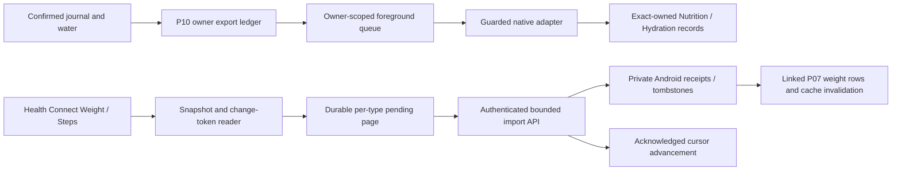

# P11 checkpoint — local Android Health Connect

Date: 2026-10-16. Branch: `codex/biteflow-p11`. Base: `579a006f5e947a651283e32659684c8b0cf6f3f8`. Final implementation: `7b78d84` (documentation/evidence commit follows).

**P11-A/B are implemented and locally verified. Full P11 acceptance is BLOCKED on device validation. P12 is NOT STARTED.** The user explicitly approved local P11 with every inherited gate and rollback caveat carried forward. This approval did not close P07–P10 device/hosted acceptance. No production operation, live AI request, push, merge, deployment or destructive migration was performed.

## Implemented scope and architecture

- Extended the existing local Expo Health module with AndroidX Health Connect 1.1.0. Default-off capability checks, install/update-required state, minimum selected permissions, revoked/partial permission handling, native rationale activity and Android 14 permission-usage alias. Ordinary logging does not require Health Connect. EN/HE settings retain iOS behavior.
- Reads WeightRecord and raw StepsRecord samples; writes NutritionRecord energy/macros and HydrationRecord only. No nutrition reimport, background read or history permission. Unknown nutrients remain absent. Existing food logs are never rewritten from imports.
- Reuses P10 canonical owner/sample/revision exports and tombstones. Namespaced `clientRecordId` plus `clientRecordVersion` support repeated writes; only exact app-owned identities are deleted. One NutritionRecord per nutrient preserves the existing identity contract; point events use a required 1 ms native interval. A failed item stays pending while unrelated work continues.
- Adds separate owner-scoped Android cursors and durable pending pages per read type. Initial 30-day snapshot captures the changes token before scanning; subsequent changes handle updates/deletions. Cursor advancement follows acknowledged uploads. Permissions are rechecked before every transfer. Expiry restarts a bounded 30-day scan and retains an incomplete-history warning; absence never means deletion. Up to 20 pages/type/run; uploads contain at most 100 events.
- Keeps original instants, source UUID/application and numeric offsets. Since Health Connect supplies no IANA history, first import explicitly chooses the journal display timezone and preserves it on later updates. Source offsets are separately disclosed. Raw steps are not claimed to be a deduplicated cross-provider total.
- Introduces one additive private table, `foodlogger.health_connect_imports`, and default-off `/api/health-connect/reconcile`, `/import`, `/imports` routes. Reconcile reuses the existing P10 ledger. Owner locks/predicates, existing custom authentication and private RLS remain. New receipts preserve latest source version, linked weight, user deletion and deletion-before-upsert tombstones. Equal-time conflicting payloads reject atomically; manual/Apple data remains separate.

## Files and components

Exact implementation inventory: [changed-files.txt](evidence/p11/changed-files.txt). Documentation inventory is the final checkpoint commit. Generated `mobile/android` and `mobile/ios` remain ignored and are generated through config, not maintained as product sources.

| Area | Paths |
|---|---|
| Server/DB | `src/foodlogger/health_connect.py`, `src/foodlogger/data/health_connect.sql`, `src/foodlogger/app.py`, `src/foodlogger/security.py`, `supabase/migrations/20261016055042_p11_health_connect.sql` |
| Native | `mobile/modules/biteflow-health/android/build.gradle`, `src/main/AndroidManifest.xml`, `src/main/java/expo/modules/biteflowhealth/{HealthAvailability,HealthPolicy,AndroidHealthGateway,BiteflowHealthModule,HealthPrivacyActivity}.kt`, module `expo-module.config.json` |
| Config/client | `mobile/plugins/with-health-connect.cjs`, `mobile/app.config.ts`, `mobile/.env.example`, `mobile/src/native/health/{android,platform,types,sync}.ts`, `mobile/src/api/endpoints.ts`, `mobile/src/components/{HealthProvider,HealthSettings}.tsx`, `mobile/src/data/tracking-store.ts`, `mobile/src/app/(app)/settings.tsx` |
| Tests | `tests/test_health_connect.py`, `tests/test_postgres.py`, native `HealthPolicyTest.kt`, mobile `connect-sync.test.ts`, `android.test.ts`, `HealthConnectSettings.test.tsx`, existing provider/settings tests (plugin assertions are in `android.test.ts`) |
| Operations | [design](p11-design.md), [plan](p11-plan.md), [device protocol](p11-device-protocol.md), [rollback SQL](rollback-p11.sql), [complete gates](p11-open-gates.md), [evidence](evidence/p11/README.md) |

## Android capability/signing review first

The default Java lookup failed, but Android Studio already contained JDK 21.0.10. Builds used `/Applications/Android Studio.app/Contents/jbr/Contents/Home` and `/Users/braude/Library/Android/sdk` per command; no global toolchain settings changed. SDK platforms 36/36.1, build-tools 35/36/36.1/37, NDK 27.1.12297006 and emulator/platform-tools were present; command-line sdkmanager was absent. Gradle 9.3.1, Expo 57.0.27 and RN 0.86.3 were inspected before implementation. Initial offline build failed because existing dependencies were uncached; dependency resolution online succeeded.

Stable Health Connect 1.1.0 declares minSDK26 while this app retains minSDK24. A narrow manifest override and explicit API28 checks protect every native SDK entry, including activity registration. API24–27 actual startup remains an open regression gate, not a proven compatibility claim. Native lint now fails on errors; production API annotations/guards replaced the initial lint errors. Test-only Java-time lint suppression applies to host JVM tests, not Android runtime validation.

Actual Debug and Release variants build for arm64-v8a. The Release APK is signed by the existing **Android Debug** certificate, not a production key. [Signing output](evidence/p11/android-signing-final.log) and [artifact SHA-256 hashes](evidence/p11/artifacts.json) are recorded. No signing portal/store operation occurred.

## Actual final test results

Exact arguments, working directories, exit codes and elapsed times: [commands.jsonl](evidence/p11/commands.jsonl). Environment isolation is in [run.py](evidence/p11/run.py): provider/app variables cleared, loopback API, AI mocked/off. Database tests used only disposable PostgreSQL 17 on `127.0.0.1:55421`. Logs include failed attempts and corrections; filenames alone do not imply success.

| Check | Actual command (relative working directory) | Result |
|---|---|---|
| Full Python including PostgreSQL | `.venv/bin/python -m pytest -q` (root, local test DB configured) | **566 passed, 9 skipped, 0 failed**; 575 collected. 71.47 s pytest / 267.66 s wrapper elapsed. Includes 28 PostgreSQL tests. |
| Browser integration | `.venv/bin/python -m pytest -m browser -q` (root, browser flag enabled) | **6 passed, 569 deselected, 0 failed**. These are six of the nine skipped above. |
| Dedicated PostgreSQL | `.venv/bin/python -m pytest -q -m postgres` | **28 passed, 547 deselected, 0 failed**; includes P11 roles/ownership/cascade. Not additional unique tests. |
| Mobile | `npm test -- --runInBand` (`mobile`) | **362 passed, 71 suites, 0 failed/skipped**, 12.525 s Jest. P10 baseline 341; 21 additional P11 cases. |
| TypeScript | `npx --no-install tsc --noEmit` (`mobile`) | PASS, exit 0. |
| JS lint | `npm run lint` (`mobile`) | PASS, exit 0, no warnings/errors. |
| Python lint/format | `.venv/bin/ruff check src tests scripts`; `.venv/bin/ruff format --check src tests scripts` | PASS, exit 0; 102 files formatted. |
| Android JVM + Debug/Release | `./gradlew :biteflow-health:testDebugUnitTest :app:assembleDebug :app:assembleRelease -PreactNativeArchitectures=arm64-v8a --console=plain` (`mobile/android`) | PASS, final 18.63 s; **12 JVM tests, 0 errors/failures/skips**. Earlier full build 233.33 s. |
| Focused native lint | `./gradlew :biteflow-health:lintDebug -PreactNativeArchitectures=arm64-v8a -x :react-native-worklets:lintAnalyzeDebug -x :expo-modules-core:lintAnalyzeDebug --console=plain` | PASS, exit 0; **0 errors, 2 warnings** in final XML. Dependency analysis excluded explicitly. |
| Full transitive native lint | `./gradlew :biteflow-health:lintDebug --console=plain` | **FAILED**: `react-native-worklets:lintAnalyzeDebug` crashes with “Cannot find a KaModule for the VirtualFile”. Full dependency lint remains BLOCKED; focused success does not replace it. |
| Existing Swift policy | `swiftc mobile/modules/biteflow-health/ios/HealthPolicy.swift mobile/modules/biteflow-health/tests/PolicyTests.swift -o .superpowers/sdd/p11-plan/policy-tests`; run executable | **13 policy cases passed**; no real HealthKit access. |
| iOS native regression | `xcodebuild -workspace ios/Biteflow.xcworkspace -scheme Biteflow -configuration Release -sdk iphonesimulator -destination 'generic/platform=iOS Simulator' -derivedDataPath ../.superpowers/sdd/p11-plan/ios-build -disableAutomaticPackageResolution CODE_SIGNING_ALLOWED=NO build` (`mobile`) | PASS, final 54.21 s; unsigned simulator Release. |
| JS packaging | `npx --no-install expo export --platform all --output-dir ../.superpowers/sdd/p11-plan/export-final` (`mobile`) | PASS; Android/iOS/web bundles, 13.73 s. |
| Clean Python packaging | `.venv/bin/python -m build --no-isolation --outdir ../dist-clean` in clean `git archive 0ce5c2e` source | PASS; wheel + sdist, 5.57 s; new module and SQL verified inside wheel. Python source unchanged through final implementation. |
| Local rollback/restore | `.venv/bin/python docs/biteflow/evidence/p11/rehearse.py` | PASS; private-role write pause, readable imports, backup/restore preserving shared identities/revision-2 tombstones/weight rows/deletion receipts. |
| Blank emulator smoke | `python3 docs/biteflow/evidence/p11/android_smoke.py` | PASS on final APK after restart, 8.06 s: install, startup/process, native rationale UI. Android17/API37 ARM64 preview image; no account/Health data. |

Unique Python outcome across full + browser runs: **572 passed; 3 optional model tests NOT RUN** (2 LiteRT, 1 TensorFlow). Optional model skips are not AI provider validation. The 569/547 deselections are filtering, not failing tests. No final functional suite failed; full dependency lint did fail. Physical-device E2E-16/19/20, real Health permission/record behavior, API24–27 runtime, store signing, hosted CI/staging and fresh dependency vulnerability audit were **NOT RUN**.

P11 targeted API suite contains 15 new tests; combined Android/Apple API suite passed 29. Android/Jest tests use fake native clients and synthetic records. None demonstrates real provider deduplication. Browser and package results precede mobile-only review fixes; their source inputs did not change. Full mobile and native builds cover the final implementation.

## Independent review and fixes

One fresh reviewer examined immutable `579a006..e0b7f0c`; 0 Critical, **3 Important**, 0 Minor. All three were confirmed and fixed in `7b78d84`, with failing regressions followed by passing affected/full suites. No second review was claimed. [Review record](evidence/p11/review.md).

1. A pending weight page with revoked weight access prevented authorized steps progress. Pending pages are now independent by kind, with compatible restoration of the earlier local queue shape.
2. Lost server acknowledgement could leave weight summaries stale when replay returned empty changed dates. Every acknowledged Android weight batch now invalidates loaded weight views and derived summaries, including deletion/date-changing updates; iOS behavior is preserved.
3. One ambiguous exact-ID deletion aborted unrelated exports/imports. Native batches now return per-item applied/failed identities; only successful items advance acknowledgements. Pending failures and repair status remain visible, while independent work continues. No deletion is falsely acknowledged.

Author verification also found/fixed minSDK compatibility integration, native API lint annotations and an inherited scaffold `abortOnError=false`. Intermediate test-harness mistakes (provider mock initialization, Jest dynamic import, rollback connecting as admin) were corrected and rerun; their initial failures are retained, not counted as product passes. Final emulator's first retry failed because its process had ended; restarting the owned blank AVD and repeating the same final APK smoke passed.

## Acceptance criteria

| Roadmap/spec criterion | Status | Supporting evidence / remaining requirement |
|---|---|---|
| P11-A bridge/config, minimum permissions, availability/install-required/partial/revoked UI | **PASS locally; runtime BLOCKED** | Plugin/adapter/settings tests, API guards and native builds pass. Real permission activity/provider matrix not tested. |
| Read Weight/Steps, write nutrition/water, correct units/instants/source | **PASS locally; device BLOCKED** | Kotlin policy tests + API receipts + queue tests. Native provider rendering/counts/offsets need device protocol. |
| P11-B stable mappings, dedup/retry/edit/delete and ownership | **PASS locally; device BLOCKED** | Revision/client identity policy, pending retries, DB role/owner tests. Real repeated writes/deletes and missing-ID repair remain unverified. |
| Incremental changes, bounded paging, lost ack and expired token | **PASS locally; provider BLOCKED** | Fake gateway/token/queue tests and explicit recovery warning. No complete-history claim after expiry. |
| Ordinary logging, food-history preservation, iOS/shared regression | **PASS in automated coverage** | Full Python/mobile/browser tests and iOS Release compile. Physical earlier-phase journeys still open. |
| Native build separate from JS export | **PASS locally** | Android Debug + Release APKs and separate Expo exports. Production signing not verified. |
| P11-C supported Android real-device stability/permissions/dedup and E2E-16/19/20 | **BLOCKED** | Only blank preview-emulator launch/rationale smoke; no permission/sync device journey. |
| Release readiness, hosted validation/privacy/signing | **BLOCKED** | Debug-signed Release variant, dependency lint crash and inherited gates. |
| Full P11 phase exit | **BLOCKED** | Required actual device validation is missing. |

## Remaining gates and next phase

[p11-open-gates.md](p11-open-gates.md) carries the complete P10 register verbatim, including every earlier gate. Real AI quotas/policy, hosted CI/staging, physical devices, exact 10% macro warning boundary, basis-correction provenance and photo protocol/held-out dataset remain visible and unclosed. No benchmark, quota or production-readiness claim was made.

For P12: explicit user approval is mandatory. Local widget work could only proceed under an explicit carry-forward decision and a separate widget capability review; this checkpoint does not authorize it. Any widget consuming Health-derived state must preserve owner isolation, unverified/incomplete-source disclosure and acknowledged cache invalidation. Physical Health acceptance, API24–27 compatibility, real deletion/reinstall/multi-device recovery and release gates cannot be silently waived by local tests.

## Commits and rollback

Five implementation/planning commits (full hashes in [implementation-commits.txt](evidence/p11/implementation-commits.txt)):

1. `1b174b0` — P11 scope and Android toolchain review.
2. `0ce5c2e` — private import receipts, gated API and schema.
3. `1a96e1a` — guarded native adapter and record policy.
4. `e0b7f0c` — incremental queue and permission-aware controls.
5. `7b78d84` — review fixes, cache recovery and native lint enforcement.

The final documentation/evidence commit is identifiable by subject `docs(biteflow): record P11 verification and blocked device acceptance`; it cannot contain its own hash. No remote PR/commit was published.

Rollback sequence, only on an explicitly authorized target:

1. Keep `FOODLOGGER_HEALTH_CONNECT_ENABLED=0` and `EXPO_PUBLIC_HEALTH_CONNECT_ENABLED=0`; pause/disconnect Android queues. Client build flags require a compatible rebuild; turning off only the server cannot recall an already dispatched native operation.
2. Preserve `health_scopes`, `health_exports`, `health_connect_imports`, P07 linked weights, native revisions and pending pages. Retain a compatible reader until pending work is resolved/exported. Do not erase uncertain operations, stable client IDs, versions or tombstones.
3. Use [rollback-p11.sql](rollback-p11.sql) to revoke new import INSERT/UPDATE while retaining SELECT/DELETE for access and erasure. No DROP, mass deletion or production execution. Restoring writes requires an approved compatible version and restored grants from the additive migration.
4. Code rollback is a new local branch from P10 base `579a006`, or reviewed reverse commits starting `7b78d84`, `e0b7f0c`, `1a96e1a`, `0ce5c2e`. **Do not deploy that downgrade blindly:** pre-P11 readers/account cleanup do not understand new Android receipts. Preserve/port compatible receipt access and erasure before downgrading any environment holding P11 data. Existing external records remain separate and require deliberate exact-owned repair; never bulk-delete third-party Health data.
5. Preserve inherited P06 label-draft compatible-reader, P07 pending measurement, P09 token/lease and P10 external-record/ledger rollback caveats. Local backup/restore demonstrated retained data, not hosted operational readiness.

The disposable PostgreSQL container/volumes, emulator and temporary local connection file were removed after verification. Existing user services were untouched. Branch/worktree are preserved; tracked state is committed, with only the pre-existing `.venv` symlink untracked. Full evidence and decision ledger are retained in Git; scratch build outputs were removed after hashes/logs were archived.
