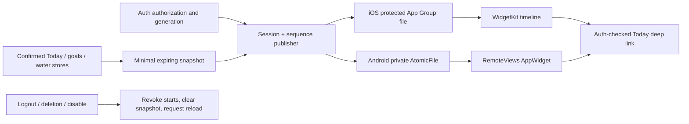

# P12 checkpoint — local native widgets

**Local P12 implementation and four review fixes are committed. Full P12 acceptance remains BLOCKED. P13 is NOT STARTED.** User authorization covers local P12 only; this report grants no release or next-phase approval. Base `a2fac88`, branch `codex/biteflow-p12`, managed worktree `/Users/braude/.codex/worktrees/biteflow-p01/food-_loger`.

## Implemented scope and reuse

- Minimal version1 Today snapshot reuses JournalStore, GoalsStore, TrackingStore and canonical goal/partial arithmetic. Calories/remaining, protein/target, goal status, optional water/target, source timestamp, local date/zone and partial/unlogged state. No credentials, account identifiers, raw meals, photos, weight or steps.
- Strict finite/bounded schema; 15-minute validity capped at local midnight; stale/optimistic/pending inputs withheld. Water now carries an internal successful-load timestamp so a new meal cannot relabel old water as fresh. No wire contract or database schema changed.
- Synchronous native bind/publish/clear, random session and increasing revision, atomic protected writes, account authorization/generation guards. Clear precedes logout,401, deletion/account replacement; pending enable/restore cannot restart after stop. Deep links enter existing auth/recovery gates.
- Android RemoteViews AppWidget in credential-protected no-backup storage, small/resizable layout with water at wider size, periodic/inexact expiry refresh, current-day validation and immutable app deep link. No network/provider use in widget.
- Tracked iOS WidgetKit small/medium extension, dedicated App Group protected file, complete-file-protection entitlement, private views, expiry timeline and reload requests. Missing capability on a fresh installation permits ordinary use; prior-data marker retains a visible cleanup gate if previously written data becomes inaccessible.
- Default-off build flag, per-account opt-in, EN/HE Settings controls and refresh/privacy/error disclosures. Invalid/signed-out/stale data uses a generic open-app placeholder rather than retaining numbers or claiming knowledge of server authentication.

No backend, API, SQL/RLS, migration, AI-provider or production configuration was changed. Native source is generated reproducibly from tracked module/plugin files; ignored native projects are not hand-maintained. No new npm dependency was added.

## Capability review before implementation

Expo57.0.27 / RN0.86.3; Xcode27.0(27A266a); Android Studio JDK21.0.10 and local SDK available. Existing floors remain iOS16.4 / Android24. SDK57 `expo-widgets` was inspected at the local SDK pin57.0.23 (archive SHA1 `352c453847ff0bd7d368e130f1aecd8cd780ddea`); its App Group UserDefaults timeline storage did not directly meet the protected-file/session contract. A small native adapter was selected. [Design/source references](p12-design.md).

Local Android Release uses the existing Android Debug certificate. iOS unsigned app+extension compilation succeeded; unsigned login hit actual Keychain -34018. A subsequent local ad-hoc simulator build emitted simulated entitlements and permitted login. No signing portal, development-account authentication, provisioning download, store or physical-device operation occurred. This does not verify production signing or real App Group protection.

## Files and components

[Exact implementation inventory](evidence/p12/changed-files.txt), [full commit hashes](evidence/p12/implementation-commits.txt).

| Area | Paths |
|---|---|
| Domain/publication | `mobile/src/native/widgets/{snapshot,publisher,lifecycle,native,session}.ts` |
| Android | `mobile/modules/biteflow-widgets/android/` policy, module, storage, provider, resources and JVM tests |
| iOS | `mobile/modules/biteflow-widgets/ios/` policy, protected file, module/pod; `mobile/widgets/ios/BiteflowWidget.swift` |
| Generation | `mobile/plugins/with-widgets.cjs`, plugin tests/fixture, `mobile/app.config.ts`, `.env.example` |
| App integration | `mobile/src/components/{WidgetProvider,WidgetSettings}.tsx`, auth provider, root layout/Settings, tracking load timestamp |
| Tests/evidence | Snapshot/lifecycle/native/auth/provider/settings Jest tests; Swift policy/capability checks; native build/install evidence |

## Actual tests and packaging

Exact arguments, working directories, return codes and elapsed times are in [commands.jsonl](evidence/p12/commands.jsonl). [Runner](evidence/p12/run.py) removes provider/application credentials, uses loopback, disables dotenv/telemetry, and uses an isolated cache for final native packaging. PostgreSQL17 used a disposable task-owned container at127.0.0.1:55422 only.

| Check | Actual command / scope | Final result |
|---|---|---|
| Backend + PostgreSQL | `.venv/bin/python -m pytest -q` | **566 passed,9 skipped,0 failed**;575 collected;99.37s pytest. Includes28 PostgreSQL cases. |
| Browser integration | `.venv/bin/python -m pytest -m browser -q`, browser opt-in | **6 passed,569 deselected,0 failed**,17.38s. These6 were skipped above. |
| Combined unique Python | Full + browser | **572 passed;3 optional model tests NOT RUN** (2 LiteRT,1 TensorFlow); no live model/provider benchmark. |
| Full mobile | `npm test -- --runInBand` | **402 passed,78 suites,0 failed/skipped**,12.834s. P11 baseline362;40 additional P12 cases. |
| TypeScript / JS lint | `npx --no-install tsc --noEmit`; `npm run lint` | Both PASS, exit0; final lint0 errors/warnings. |
| Python lint / formatting | `.venv/bin/ruff check src tests scripts`; `.venv/bin/ruff format --check src tests scripts` | PASS;102 files formatted. |
| Android JVM + native variants | `./gradlew :biteflow-widgets:testDebugUnitTest :biteflow-health:testDebugUnitTest :app:assembleDebug :app:assembleRelease -PreactNativeArchitectures=arm64-v8a --console=plain` | PASS36.30s; **10 widget +12 Health JVM tests,0 failures/errors/skips**. |
| Focused native lint | `./gradlew :biteflow-widgets:lintDebug -PreactNativeArchitectures=arm64-v8a -x :react-native-worklets:lintAnalyzeDebug -x :expo-modules-core:lintAnalyzeDebug --console=plain` | PASS; **0 errors,8 warnings**. Exclusions explicit. |
| Full native lint | `./gradlew :biteflow-widgets:lintDebug --console=plain` | **FAILED**: inherited Worklets `Cannot find a KaModule for the VirtualFile`; complete dependency lint BLOCKED. |
| Swift widget policy/storage | `swiftc` policy + `PolicyTests.swift`, then executable | **13 checks passed**. |
| Swift capability/clear | `swiftc` policy/file + `FileTests.swift`, then executable | **3 checks passed**; prior-data capability loss still gates access. |
| Existing Swift Health policy | `swiftc` Health policy + existing tests, then executable | **13 policy cases passed**. |
| Native iOS | `xcodebuild -workspace ios/Biteflow.xcworkspace -scheme Biteflow -configuration Release -sdk iphonesimulator -destination 'generic/platform=iOS Simulator' -derivedDataPath ../.superpowers/sdd/p12-plan/ios-build -disableAutomaticPackageResolution CODE_SIGNING_ALLOWED=NO -jobs 4 build` | PASS356.87s on final implementation. Separate local ad-hoc simulator build `CODE_SIGNING_ALLOWED=YES CODE_SIGN_IDENTITY=-` PASS35.67s. |
| JS packaging | `npx --no-install expo export --platform all --output-dir ../.superpowers/sdd/p12-plan/export-final` | PASS22.67s; Android/iOS/web bundles. |
| Clean Python packaging | `.venv/bin/python -m build --no-isolation --outdir ../dist` in clean `git archive 26341ac` | PASS1.60s; wheel+sdist. Python unchanged in later commits. |
| Final Android cache/package | Bundle task `--rerun-tasks`, isolated TMPDIR; `:app:assembleRelease` | PASS20.13s +8.48s; packaged API address verified loopback. |
| Installation/signing | Android adb install + apksigner; iOS simulator install/launch | PASS locally; Android Debug signature, iOS simulator-only ad-hoc. [Artifact hashes](evidence/p12/artifacts.json). Build outputs are local test artifacts, not release distributions. |

The first DB run had538 passes,9 skips and28 fixture errors because its name lacked required `_test`; corrected test-only DB passed. First browser run had4 passes/2 server-start errors under concurrent native load; rerun passed6. First lint failed3 errors/4 warnings; corrected final lint passes. Red regression runs intentionally failed. Initial iOS module-name collision, stale derived outputs, then missing CFBundleName installation failure were reproduced and fixed. Logs retain all failures. Initial Android Metro output retained an old test API address; isolated TMPDIR resolved the cache issue before final fixture sign-in. No assertion of success relies on an unexecuted check.

## Regression and review

P01–P11 automated Python/mobile/browser suites are green; Android/iOS Health host tests pass. No backend source or schema changed. These results do not prove every prior physical/native journey or hosted migration gate. Complete inherited register is preserved verbatim in [p12-open-gates.md](p12-open-gates.md).

One independent fresh reviewer inspected `a2fac88..26341ac`:0 Critical,4 Important,0 Minor. All four confirmed findings were fixed in `d781c9d`, with failing regressions followed by passing affected/full suites. No second review is claimed. [Review details](evidence/p12/review.md).

1. Pending preference restore/enable restarting publication after logout/disable: auth authorization plus captured generations now invalidate every pending start and block new starts until a current account opens.
2. Previous-day totals accepted after device time-zone travel: native validators now check the current device-local day in addition to the snapshot zone.
3. Missing App Group blocking fresh ordinary app: explicit degraded path for no-prior-data installations; durable non-sensitive marker preserves the gate for previously written data.
4. Missing required extension CFBundleName: generator fixed; metadata check, native build and actual installation repeated successfully.

Author verification additionally fixed independent water freshness, cleanup of the latest publisher, deletion clear ordering, native numeric coercion, and extension module-name collision. No unresolved Important/Critical finding from this review remains. Physical semantics below remain unverified.

## Observed native smoke and limits

Android API37 preview emulator: actual gallery search/add2x2, signed-out placeholder, auth-checked widget tap, synthetic loopback sign-in and opt-in, unlogged/no-goal state, foreground refresh after a local API-confirmed133.5kcal meal ->widget134kcal/2g protein, timestamp, confirmed logout ->placeholder without old totals. [Details](evidence/p12/android-smoke.md), [data screenshot](evidence/p12/android-small-data.png), [logout screenshot](evidence/p12/android-after-logout.png). This does not test the complete app meal-entry journey, every launcher/size, or physical-device privacy.

iOS 26.5 task-owned iPhone 17 Pro simulator: actual small/medium widget choices appeared in the app icon context menu. Small placement displayed a signed-out placeholder and tapping opened Sign in. After the local ad-hoc simulator build resolved the unsigned Keychain failure, synthetic loopback login and Settings opt-in succeeded. The small widget displayed **134 kcal / Protein 2 g / No calorie goal / Updated 10:48** from the same confirmed meal; the medium widget also displayed **Water 0 ml**. Tapping returned to Today. Confirmed logout returned to Sign in; the protected snapshot file was absent, and the medium home-screen widget displayed the generic placeholder without prior totals. [Details](evidence/p12/ios-smoke.md), [small](evidence/p12/ios-small-data.png), [medium](evidence/p12/ios-medium-data.png), [after logout](evidence/p12/ios-after-logout.png), [file check](evidence/p12/ios-file-after-logout.log). This verifies those local observations only; full gallery search, physical protection, other OS versions, Hebrew/accessibility and killed/background behavior remain unverified.

## Acceptance criteria

| Requirement | Status | Evidence / remaining limit |
|---|---|---|
| P12-A minimal protected snapshot, finite/partial/unknown/confirmed values | **PASS locally** | TS+Kotlin+Swift tests; no credentials/raw meal payload. Real protection/backup behavior needs device evidence. |
| P12-A logout/deletion/account/date lifecycle; stale/interrupted/corrupt/late writes | **PASS automated; physical BLOCKED** | Generation/sequence, race, corruption, expiry and travel regressions; Android/iOS observed logout; iOS file absence checked. General OS-cached pixel behavior remains unverified. |
| P12-B SDK57 evaluation, tracked WidgetKit target, App Group, small/medium | **PASS local implementation/build/install; device BLOCKED** | Evaluation/source, config tests, extension native build/install. Physical entitlement/signing/gallery/size matrix open. |
| P12-C tracked Android AppWidget, protected reader and scheduling | **PASS local implementation/emulator smoke; device BLOCKED** | Native builds/tests, gallery installation and observed refresh/logout. API24+, multiple launchers/killed scheduling open. |
| Confirmed changes request refresh; auth deep links | **PASS local coverage; full E2E BLOCKED** | Lifecycle tests and native observed links/foreground refresh. End-to-end confirmed app edits + eventual OS updates across matrix still required. |
| HE/EN, RTL, accessibility, large text and size matrix | **BLOCKED full acceptance** | EN/HE component/policy tests; full visual/device matrix not executed. |
| F18/P12 real-device exit and E2E-17/19/20 | **BLOCKED** | No compatible physical-device run. Local install or test success does not satisfy the required physical acceptance. |
| Production readiness / P13 progression | **BLOCKED** | Signing, full dependency lint, hosted CI/staging, privacy and all inherited gates; explicit P13 approval required. |

## Commits and rollback

1. `96b47ea` — P12 capability/privacy design and implementation plan.
2. `c9b1e9a` — minimal expiring snapshot and publication contract.
3. `facec6d` — native WidgetKit/Android adapters and config generation.
4. `26341ac` — canonical stores, auth lifecycle and widget settings.
5. `d781c9d` — four independent-review fixes and regressions.

Evidence/checkpoint documentation is committed separately. No push/PR/merge/deploy occurred.

Rollback only on an approved target: first hide widget data or sign out through the compatible P12 bridge; revoke pending publications, clear only widget-owned protected file and request native reload. Verify both storage and displayed copy. Keep cleanup code, prior-data marker and App Group entitlement until prior snapshots are removed; disabling the build flag alone cannot recall OS-cached pixels. Then rebuild with `EXPO_PUBLIC_WIDGETS_ENABLED=0`; native extension removal requires a separately approved future compatible build. Do not blindly downgrade to P11 with existing widget snapshots. After verified cleanup, create a local branch from `a2fac88` or review reverse commits in reverse order. No DB down-migration is required. Journal, goals, water, Health mappings and all inherited P06 label-draft/P07 pending measurement/P09 token-lease/P10–11 external-record/receipt caveats are retained.

[Complete gates](p12-open-gates.md), [device protocol](p12-device-protocol.md), [decision ledger](evidence/p12/execution-ledger.md). No live AI, provider charges, production modifications, destructive migration, push, merge or deployment. P13 remains unopened.

## Final local workspace state

Task-owned loopback API, disposable PostgreSQL container/volume, Android emulator and iOS simulator were stopped/removed after capture. Owned scratch/build cache, synthetic token response and test connection file were removed after the ledger, complete compressed logs, screenshots and hashes were archived. The managed development worktree and existing `.venv` symlink are preserved. [Cleanup evidence](evidence/p12/cleanup.jsonl), [state verification](evidence/p12/final-local-state.json). Implementation has not changed since final tests. The checkpoint/evidence commit is the sixth P12 commit; its hash is returned with this report.
