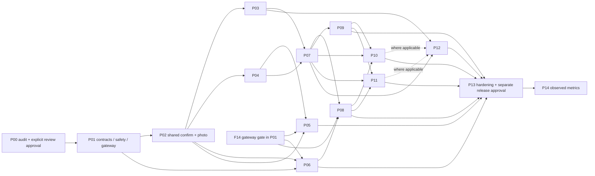

# BiteFlow repository-adapted implementation plan — P01–P14

> **For agentic workers:** REQUIRED SUB-SKILL: Use superpowers:subagent-driven-development (recommended) or superpowers:executing-plans to implement this plan task-by-task. Steps use checkbox (`- [ ]`) syntax for tracking. **This is a future handoff, not authorization to execute. P00 only was requested. The user must explicitly approve before P01, and choose any desired delegation method.**

**Goal:** Extend the existing BiteFlow journal to all F01–F20 while preserving working accounts, logs, barcode/photo/manual flows and historical nutrition.

**Architecture:** Retain FastAPI, custom opaque-session authentication, private PostgreSQL/SQLite repositories, Expo Router and the existing draft/save lifecycle. Adapt current input paths into a canonical draft and shared editor, add owner-scoped domain modules behind the current API, and use deterministic nutrition/statistics with a server-enforced AI gateway. Add native adapters only after build/permission feasibility is demonstrated.

**Tech stack:** Python 3.11–3.12, FastAPI/Pydantic, SQLite/psycopg PostgreSQL; Expo SDK 57, React Native 0.86, React 19, TypeScript, Jest; pytest/Ruff/Playwright and existing GitHub Actions. Versioned SDK documentation must be rechecked before dependency selection.

**Spec:** [BiteFlow_SPEC_EN.md](requirements/BiteFlow_SPEC_EN.md) and [BiteFlow_IMPLEMENTATION_PLAN_EN.md](requirements/BiteFlow_IMPLEMENTATION_PLAN_EN.md). Baseline and evidence: [current-state.md](current-state.md). Per-feature migration/interface/UX/test/rollback tickets: [implementation-matrix.md](implementation-matrix.md).

**Status:** Every checkbox below is **NOT STARTED**. These PR IDs are planning identifiers, not existing GitHub PRs. No implementation, migration, paid call, production action, push or deployment is authorized by this file.

## Global constraints

- One normalized editable draft and explicit confirmation for every input, including repeat/recipes/recommendations. No AI auto-save.
- Unknown is not zero; no NaN/infinity; g/ml need food-specific density for conversion; sodium mg is distinct from existing sodium g. Preserve original quantities, units, confidence, source/version and user overrides.
- Canonical arithmetic retains precision until display. Historical snapshots are never silently recomputed. Verified label kcal is not overwritten by a 4/4/9 estimate. `kcal = kJ / 4.184` only when conversion is needed.
- Canonical timestamps include assigned local date, occurred-at and timezone context. Goal revisions take effect on their local effective date. Never invent legacy consumed times.
- Keep authenticated owner predicates on every query; private schema RLS does not replace them. Do not migrate custom accounts to Supabase Auth as an incidental feature change.
- Additive/backfillable schema first; separate migration activation from feature activation. Test SQLite and PostgreSQL plus old-client contracts. No destructive production changes or production release without separate explicit approval.
- Live provider use stays disabled when billing/allowance is unverified. The 500/350/150 proposal is configurable, not an account fact. No automatic paid fallback or extra AI passes without measurement and approval.
- One phase gate at a time; do not implement three major phases simultaneously. P10/P11 may be independent platform tracks only after their common prerequisites and explicit authorization. A failed DoD blocks dependent work.
- Preserve Hebrew RTL/English LTR, Orbit dark theme, existing deep links and account lifecycle. Every state must have understandable feedback; unsupported native capabilities do not block ordinary logging.

## Review focus and design freeze proposals

These decisions are proposed for review; they are not existing implementation:

1. **Keep one journal.** Add meal-level grouping/metadata to the current component rows instead of introducing a parallel unrelated `meal_logs` subsystem. Add a `meal_groups` header and reference from `meals`; preserve every existing row ID and snapshot. Existing analyzed `details.group_id` supplies grouping where trustworthy; legacy rows become single-item groups. Recipe/product references remain traceability only.
2. **Separate retry receipts from food rows.** An owner/request receipt contains payload digest, result identities, operation/version and deletion state. Deleting a meal must not permit its old create request to recreate it. Reuse `Idempotency-Key` at the HTTP boundary as the canonical `client_request_id`; never generate two independent keys.
3. **Stage nullable/precise nutrition compatibility.** Add versioned canonical snapshots and deploy readers/adapters before new writers. Preserve old totals exactly. Existing complete-core v1 saves remain supported. Do not enable persisted partial-core logs or sub-1g writes until schema widening and old-client behavior are approved/tested; never fill required legacy columns with invented zero. PostgreSQL constraint widening and SQLite table rebuild, if needed, are a separate migration review with restore rehearsal. This compatibility gate must be resolved before claiming full P02 acceptance.
4. **Keep assigned historical days.** Backfill `local_date` from existing `day`; mark timezone/occurred time as unknown when absent. Do not label `created_at` as measured consumption time or infer timezone from the current phone. Copy requires explicit/known local time or a visibly confirmed default for legacy entries.
5. **One nutrition engine policy, not one language runtime.** Python is authoritative; TypeScript preview uses the same versioned fixtures/contracts. New precision policy may differ from current half-up-per-item tests, so old log display and new calculations must be distinguishable.
6. **Central gateway before AI consumers.** Wrap existing `GeminiVision` rather than replace it. Use PostgreSQL/SQLite transaction-backed reservations with a documented multi-worker policy. Provider RPM/TPM/day reset is separate from the user's journal day. A timeout after transmission remains possibly consumed.
7. **Preserve current routing.** Extend the Add modal, Today and Settings stack with Trends/library/tracking routes; keep `/add/review` and current meal deep links. Reuse/refactor `MealFoodEditor` for the common editor; do not add a third editor.
8. **Preserve the legacy browser.** Update compatible response handling and retry keys in `static/app.js` when required. New mobile screens need not be duplicated as a new web product, but old browser journaling/export must keep working.
9. **Resolve earlier proposal differences.** The local library/speed proposal suggests behavior beyond/different from this spec. Shared explicit confirmation and unrounded intermediate math from the supplied spec take precedence here. A model switch, instant-save shortcut or nutrition policy change requires its own reviewed decision.

Five especially important test classes, assigned below: (a) response-lost → delete → replay resurrection, P01-C; (b) unknown nutrients on an older installed client, P01-B/P02-A; (c) same account traveling across Jerusalem DST boundaries, P01-A/P04-E; (d) account switch while persistence/analysis/sync is in flight, P01-D/P10-B/P12-A; (e) provider timeout/retry crossing quota reset, P01-E/F. These tests are currently incomplete even though baseline checks pass.

Gateway concurrency guarantees cover traffic routed through this gateway. Identify other consumers of the same provider project, reserve headroom and reconcile provider-reported usage; an application ledger cannot guarantee total project usage if unrelated callers bypass it.

## Dependency and release map

Recommended execution order: **P01 → P02 → P03 → P04 → P05 → P06 → P07 → P08 → P09 → P10 → P11 → P12 → P13 → approved release → P14**. P05 can safely precede P06 because the P01 contract supports unknown food-specific units and asks for quantities; it must not guess a half-pita conversion. F14 is a P01 prerequisite, not a late phase.

Release slices match the supplied plan: R1 P00–P03 + basic P04 repeat/recipes; R2 finish P04/P05/P06; R3 P07/P08/P09; R4 P10/P11/P12; R5 P13/P14. These are scope milestones, not permission to release R1–R4. Native features lacking device evidence remain blocked and flagged off; any release omitting them must explicitly describe that scope.

## Implementation protocol and validation commands

For each authorized PR below: identify existing tests/behavior, add meaningful failing tests for the acceptance cases, make the smallest change, run the relevant checks, inspect the diff, and update the matrix with evidence. A refactor and feature can be reviewed separately; a schema migration and activation should be separate PRs. Do not create external PRs or deploy as part of P00.

Standard check sets (future implementations should record actual output, not copy P00 counts):

| Code touched | Commands / required result |
|---|---|
| Python domain/API | `.venv/bin/ruff check src tests scripts`; `.venv/bin/ruff format --check src tests scripts`; `.venv/bin/python -m pytest -q` plus named new tests; zero failures |
| Mobile | In `mobile`: `npm run typecheck`; `npm run lint`; `npm test -- --runInBand`; UI evidence for changed screens in both languages |
| Browser/API compatibility | Sanitized local environment: `FOODLOGGER_RUN_BROWSER_TESTS=1 .venv/bin/python -m pytest -m browser -q`; existing journeys and new retry/partial handling pass |
| SQL/schema/transactions | Dedicated disposable `_test` database only: `FOODLOGGER_TEST_DATABASE_URL=<disposable-local-test-DSN> .venv/bin/python -m pytest -m postgres -q`; migration forward/backfill/resume/restore fixtures; never point these destructive fixture setups at production |
| Package/bundle boundary | Build sdist/wheel from a clean source snapshot; local Expo iOS/Android export with explicit non-production URL. New native modules additionally require platform build and device evidence; export is insufficient. |
| Photo/OCR | Evaluate identical licensed/adjudicated split and report raw results, failures, request count/cost and current commit. Local fixtures first; external calls only with verified allowance and authorization. |

Every new API test includes owner A vs B, unauthenticated/expired session, malformed/oversized values, retry conflicts and account deletion where material. Every cache-changing operation invalidates day/trends/insight and requests enabled widget/sync updates through one event/revision mechanism. Default tests use mocked provider transports; do not add live AI calls to routine CI.

## P01 — Data contracts, security and safe migrations

**Entry:** P00 reviewed and explicitly approved. Confirm intended source branch: local `mobile-app` includes the mobile app; remote `main` is currently backend-only. Do not push this branch to Render's deployment branch as incidental setup.

**Interfaces:** NEW `src/foodlogger/domain.py` (Pydantic FoodReference, NutritionPer100, Portion, MealDraft/Item, canonical snapshot); NEW `src/foodlogger/nutrition_engine.py`; extend `mobile/src/domain/{nutrition,drafts,meal-analysis,dates}.ts` with version adapters. Contract carries schema/calculation version, original and normalized units, nulls, warnings, provenance, occurred-at/local date/zone, input/category and stable client request identity.

- [ ] **P01-A — canonical contract and arithmetic fixtures.** Modify current Python/TS domain modules and tests; add cross-language JSON fixtures under `tests/fixtures/biteflow/` (NEW). Define `normalize_portion`, `scale_nutrients_exact`, `aggregate_nutrients` and `adapt_legacy_draft` semantics. Test 0 vs null/partial, finite bounds, kJ 418.4 -> 100 kcal, sodium 0.1g -> 100mg, density-required ml/g, 3 × 0.14 exact subtotal, Hebrew numbers, UTC/local-date/DST. Keep old saved values unchanged and tag legacy provenance/time unknown.
- [ ] **P01-B — compatibility readers and additive schema.** Extend `database.py`, `storage.py`, `schemas.py`, `analysis_schemas.py`, mobile `api/types.ts`, `static/app.js`; NEW migration support module/ledger if needed. Create separately reviewed PostgreSQL and SQLite additions for `meal_groups`, canonical metadata, ownership/indexes and migration/backfill progress; no first-stage table drops/renames. Backfill on a disposable copy preserving IDs/day/totals/grouping and unknowns; rerun idempotently and interrupt/resume. Test old clients reading complete records. Document and gate any subsequent constraint widening/table rebuild needed for partial-core or tiny portions; incompatible clients must not receive falsely complete nutrition.
- [ ] **P01-C — durable save receipts and meal mutations.** NEW `src/foodlogger/meal_service.py`; adapt `analysis_journal.py`, existing save routes and `storage.py`. Add owner+request unique receipt with digest, operation/schema and result identities; save receipt+group+items transactionally. `POST /api/meal-logs` is a canonical facade over the same journal, with existing routes adapting to it; `PATCH/DELETE /api/meal-logs/{id}` use version checks. Extend `mobile/src/api/client.ts` to PUT/PATCH with authentication/error tests. Add stable draft retry keys to `static/app.js`, which currently omits them. Test lost response (including browser resubmission), 100 competing identical requests, changed content 409, partial/all component deletion, retry tombstones, failure mid-transaction, cross-user IDs and deletion races. Rehearse behavior in SQLite and PostgreSQL. Old complete saves still work.
- [ ] **P01-D — draft durability and invalidation.** Extend `DraftProvider.tsx`, `save-draft.ts`, `journal-store.ts`, `storage/{kv,account-data}.ts`, auth cleanup. Define `onLogChanged(owner, dates, revision)` and versioned cache keys; invalidate in-flight reads after mutations. Surface failed draft persistence/outcome-unknown saves; migrate or safely retain old drafts. Tests: disk full, interrupted request, refresh-vs-write/delete race, account switch, expiry, logout/delete erasure, stale draft schema and restart. No new auto-save-on-reconnect behavior.
- [ ] **P01-E — gateway ledger/reservation service.** NEW `ai_gateway.py` and separate SQL/SQLite additions for policies, reservations and attempts. Wrap provider invocation in `reserve_ai_call(owner, feature, provider, model, request_id, token_estimate)`, then settle usage/outcome. Atomic multi-worker enforcement of daily/RPM/TPM limits and photo reserve; every actual retry has an accounted attempt. Policy distinguishes journal timezone from provider reset zone. Test concurrent 100-request bursts, project vs user caps, process restart, uncertain consumption, reset boundaries and no-overshoot; no provider traffic.
- [ ] **P01-F — flags, quota evidence, admin access and CI.** NEW server feature/capability config; add mobile checks to `.github/workflows/ci.yml`; return read-only capability flags to supported clients. Establish explicit server-managed admin identity for budget metadata, with no raw diet/photo text in logs. Verify existing provider project/model/tier/billing/allowance through a working account view before enabling live calls; record evidence and reviewed budget (500/350/150 only if selected and within allowance). Verify independent non-production fixtures/role grants and backup/restore procedure. Preserve current environment variable names/provider adapter and healthy legacy behavior.

**Exit/gate:** shared contract fixtures pass, legacy snapshots unchanged, canonical save/receipt security and concurrency pass on both DB engines, local/staging fixtures operate, forward/backfill/restore rehearsed, flags enforce server-side, quota verified before live activation. No production migration. Unresolved legacy partial-data compatibility or PostgreSQL access blocks applicable acceptance, not a claim of completion. **Rollback:** disable new writer/AI flags, keep additions/receipts, use compatible readers, stop/resume backfill; never delete new nutrition or receipts to roll back.

## P02 — Unified confirmation and photo hardening

**Entry:** P01 gate passed. F20 is already substantive; start by adapting it, not recreating recognition.

- [ ] **P02-A — canonical adapters.** Adapt `AnalysisResult`, catalog, manual and OFF products into `MealDraft` using `domain/drafts.ts`, `meal-analysis.ts`, `api/meal-analysis-types.ts`, backend schemas. All use one canonical save facade and request identity. Runtime-validate responses; preserve old persisted drafts and explicit unknown fields/source corrections. Tests compare equivalent input across adapters; no journal mutation before confirmation; verify complete old client flows and chosen partial-data policy.
- [ ] **P02-B — one editable confirmation component.** Refactor `add/review.tsx`, `MealAnalysisReview.tsx`, `MealFoodEditor.tsx`, `NutritionGrid.tsx` into a common item-list review, not another route. Support add/remove/rename, quantities/basis, source/confidence/warnings, date/time/category and item/meal totals. Keep barcode optional fields and catalog selection. Add date/time/quantity validation, loading/error/offline/cancel/permission states. Test multi-food, missing nutrient, empty removal, large text/RTL and lost-response draft retention; capture current screenshots on both platforms/languages.
- [ ] **P02-C — benchmark and targeted recognition fixes.** Preserve `prepare_image`, `vision.py` prompt/schema, `nutrition_reference.py` and fixtures; expand adjudicated data per audit. Measure current configured provider with approved allowance, cold/warm latency, total attempts/tokens/cost, abstentions, visible-item P/R, per-item portion error, meal kcal MAE and interval coverage. Predeclare held-out acceptance/regression thresholds with reviewer. Fix only evidenced weaknesses (e.g. generic recipe matching/sauce ambiguity) in isolated follow-up PRs. Do not add segmentation/extra model passes absent measured benefit.
- [ ] **P02-D — photo flow reliability and compatibility gate.** Wire an explicit cancel/timeout state in `photo.tsx`/API client where feasible, without pretending to cancel an already-consumed provider call. Test three-food plate and ambiguous/non-food cases, second-angle dedup, malformed/oversized outputs, provider 429, quota reserved for photos and manual recovery; no auto-save. Run existing browser + mobile flows and actual device photo/gallery -> edit -> save once available.

**Exit:** E2E-01/18/20 pass within stated device scope, all inputs in scope reach the shared editor, measured quality/cost report supports changes, no unknown-as-zero or intermediate-rounding workaround. No full photo-quality completion from mocked outputs. **Rollback:** flag common editor/resolver/provider changes separately, keep compatible draft readers and legacy endpoints; stored nutrition stays fixed.

## P03 — Goals, DayDial and Today

**Entry:** P01–P02 passed. Tickets F01, groundwork for F19.

- [ ] **P03-A — goal revisions API.** NEW `goals.py`, owner goal-revision migration and tests; `GET/PUT /api/goals` from matrix. Atomic revision/effective-date change and concurrency check; manual kcal/macros/water/optional target weight. Test positivity/plausibility, energy-macro mismatch warning, 90–110% calorie band, protein >=100%, tomorrow revision does not rewrite yesterday.
- [ ] **P03-B — goal settings and daily read model.** NEW `(app)/goals.tsx`, domain goals/API types; extend Settings and `GET /api/daily-summary?date=` over current log service. Explicit partial nutrient totals and no-goal response; merge no new authoritative duplicate intake store. Test unset/partial/offline/error and optimistic rollback.
- [ ] **P03-C — clock and progress UI.** Extend `DayDial.tsx`, Today, `journal-store.ts` and i18n; retain clock/deep links while adding consumed/target/remaining/progress and macro bars with accessible labels. Test 2,300 kcal/150g target, adding/editing/deleting lunch, effective-date/history, cache refresh and large-text Hebrew/English screenshots.

**Exit:** E2E-04/20, consistent Today on every mutation, transparent incomplete-logging meaning. **Rollback:** disable new dashboard/goals UI while preserving revisions and existing clock/journal.

## P04 — Fast logging, recipes and copy

**Entry:** P02 passed; P01 receipts/dates ready. Tickets F04/F05/F08. First A–D basic slice can close R1; finish all before R2/P05.

- [ ] **P04-A — recents/favorites service.** NEW `library.py`; reuse current meal groups/snapshots. Paginated/searchable recents default 20, favorites unique by owner/type/source; snapshot expansion does not join mutable nutrition for old logs. Owner tests, unfavorite not delete, deleted source/recipe behavior and account erasure.
- [ ] **P04-B — Quick Add and repeat adapter.** NEW `(app)/library.tsx`, extend Add modal, common draft/portion preview. Repeat generates a new date/ID, deterministic scaling, explicit confirmation and stable retry key. Test **zero AI invocations** with a rejecting provider stub, 1–2 actions from Quick Add for default serving where UX allows; measure actual interactions. Offline cached selection can form a draft, never report unsaved work as saved.
- [ ] **P04-C — recipe persistence and versioning.** NEW `recipes.py`, recipe header/item migrations and fixtures. Read/create/update/delete/duplicate API; atomically validate ingredients and serving yield, optimistic version/updated-at conflict. Frozen logged snapshots survive recipe update/deletion. Test two servings, fractions, version races, mixed-unit/density/yield ambiguity and ingredient removal.
- [ ] **P04-D — complete recipe editor.** NEW `(app)/recipes/index.tsx`, `[id].tsx`; reuse shared item editor and canonical draft. Full CRUD/duplicate, total/per-serving preview, serving count before confirm, empty/partial/errors and conflict-resolution UI. Verify no duplicate library entry when a favorite points at the same recipe. E2E-05/06, RTL/large type.
- [ ] **P04-E — meal/day copy service and preview.** NEW `copying.py` + `(app)/copy.tsx`. Source selection, destination date, preview then confirmation; populated date extra warning, request receipt, immutable copied-from snapshot, no goal copying. Preserve known local times through DST; explicitly resolve gap/overlap and legacy unknown time. Test empty/populated dates, partial selection, retry/concurrency, deleted source/permission failure and original data unchanged (E2E-07).

**Exit:** zero-AI repeat measured, full recipe editing/version history works, copy-date/DST/idempotency tests pass. **Rollback:** disable library/recipe-write/copy flags independently; existing logs and receipt/tombstone records remain.

## P05 — Text and voice

**Entry:** P02/P04 and F14 passed. Tickets F06/F07. Household conversion uncertainty remains explicit until P06 evidence exists.

- [ ] **P05-A — deterministic text adapter and budgeted ambiguity fallback.** NEW `text_input.py`, `(app)/add/text.tsx`, Hebrew/English fixture corpus; parse quantities/known units/aliases, return canonical draft. `חצי פיתה עם חומוס וביצה קשה` separates three foods and asks unknown mass; `200g chicken with rice and salad` does not apply 200g to every item. Test code-switching, partial quantities, unsupported foods, no-AI ordinary phrase, bounded AI schema/429 fallback and zero pre-confirm writes.
- [ ] **P05-B — speech feasibility and native adapter.** Record actual SDK 57 bridge choices, supported device/OS/language/on-device availability and permission lifecycle. NEW `native/speech.ts`; config plugin/lockfile change in its own review. Change blocked microphone permission only for approved voice functionality. No cloud STT by default; an approved fallback needs privacy and gateway accounting. Test denied/unavailable/revoked permission, stop/cancel/background interruption and artifact cleanup.
- [ ] **P05-C — editable voice transcription UI.** NEW `add/voice.tsx` routes transcript through F06. Verify required Hebrew phrase and English on supported devices, edit without rerecord, denied permission -> text; collect transcript correction/error evidence. No separate nutrition parser or raw-audio retention beyond operational need.

**Exit:** E2E-02/03/14/18/20; parser, editor and allowance remain consistent. Device-STT acceptance blocked when untested, with text usable. **Rollback:** disable voice/cloud or ambiguous-AI independently, retain deterministic text/manual entry.

## P06 — Israeli sources, household measures, barcode and OCR

**Entry:** P01–P02/F14 passed. Tickets F09/F10/F11; retain current OFF/barcode client.

- [ ] **P06-A — source adapter/licensing and aliases.** NEW `food_providers.py`; extend existing USDA import/search and OFF normalization. Document accessible official Israeli source/format/license/freshness or inability to use one; fallback to lawful existing sources and private confirmed foods explicitly satisfies the approved alternative. No production import. Use dry-run validation/checksums/provider version and conflict precedence; Hebrew aliases for the listed regional foods, recipe-dependent ambiguity and duplicate disambiguation. Test exact product beats generic match and source failure/provenance visibility.
- [ ] **P06-B — evidence-backed serving conversions.** NEW `servings.py`, conversion migration, mobile shared unit selector. Add food/version/unit-specific weights/densities with evidence/confidence and original-unit snapshot. Test half-pita from selected pita, tahini tablespoon vs rice tablespoon, teaspoons/cups/pieces/slices/size in Hebrew/English, missing density -> clarification, quantity updates totals without silent unit changes. No universal mass assumption.
- [ ] **P06-C — label extraction and normalization.** NEW `label_input.py`, `add/label.tsx`; evaluate actual Hebrew on-device OCR before choosing it, otherwise approved gateway provider. Crop/deskew when beneficial; parse product/name, kcal/kJ, g/ml, per-100/per-serving, sodium/salt, protein/carbs/fat/sugars/saturates/fiber. Carry uncertain field evidence. Golden real-label transcriptions plus malformed/rotated/dual-basis tests; exact barcode candidate reuse.
- [ ] **P06-D — private product confirmation and integration.** Add owner/versioned private-product persistence and review reuse, not global catalog publication. Cache label fingerprints per owner with bounded retention. Test correction, normalization, cross-user access, same label retry, missing nutrients, kcal+kJ not double conversion, real Israeli product and OCR field/correction metrics (E2E-08/09/18/19).

**Exit:** source licensing conclusion documented, tested regional product/serving/OCR path, no invented values/public publication; Hebrew quality evidence, not an SDK support assumption. **Rollback:** disable new provider/conversions/OCR separately; preserve source-version snapshots, OFF and manual fallback.

## P07 — Weight, water and trends

**Entry:** P03–P04 passed. Tickets F02/F03/F19.

- [ ] **P07-A — tracking repositories and CRUD.** NEW `tracking.py`, owner-scoped weight/water migrations and API. Weight kg by measurement time/source/external ID, water ml by timestamp/local date/zone/request key; source uniqueness and versioned edit/delete. Add account deletion/export policy, API and direct-role tests. 250+500=750; deleting 250 leaves 500; meal beverage volume creates no water entry.
- [ ] **P07-B — deterministic period analytics.** NEW `trends.py` and domain fixtures over logs, goal revisions, water and weight. Week/month/previous comparable period; logged-day denominators, gaps, daily latest weight, measured-date average and effective goal join. Three logged days/four absent -> divide by three; no zero-fill; clarify optional logging-complete status if included. Add indexed bounded queries and fixture query-performance measurements.
- [ ] **P07-C — tracking screens/charts/Today integration.** NEW weight/water/trends routes, quick water buttons, display kg/lb/ml/fl oz without changing storage. Labeled calorie/weight dual axes with toggleable layers, latest/delta/targets, source/estimated/missing states, chart accessibility and exact period dates. Common invalidation covers edit/delete and historical records. E2E-10/11/12/19/20 plus offline/rollback and screenshot evidence.

**Exit:** arithmetic, missingness, chronology and units verified, Today immediately consistent with confirmed water/log changes. Later health/widgets subscribe only when their phase is ready. **Rollback:** disable write/chart flags; preserve measurements/goals; evict derived series only.

## P08 — Weekly insights and meal recommendations

**Entry:** P07/P06/F14 passed. Tickets F12/F13.

- [ ] **P08-A — summary statistics/templates and cache.** NEW `insights.py` consumes the exact F02 read model, user/week/data+goal revision cache. Hebrew/English templates report averages/adherence/meal distribution/prior comparison with explicit insufficient data. Test three-day week, corrected historical entry invalidation and equality with Trends; never unsupported breakfast claims.
- [ ] **P08-B — restrictions and deterministic meal ranking.** NEW `recommendations.py`, optional preference/allergy storage and privacy UI. Filter before ranking familiar foods/recipes against remaining goals; return 2–4 plausible choices when available with deterministic portions/nutrients and uncertainty. Unknown allergies are not “none”; declared allergies with unknown ingredients require conservative exclusion. Test 500 kcal/40g remaining + allergy, no safe candidates and incomplete goals. Choice opens shared draft, never saves.
- [ ] **P08-C — optional bounded AI wording.** Send only necessary verified structured metrics/candidates through gateway; validate returned numbers/candidate IDs and fall back to templates/rules on mismatch, timeout, quota or unavailable model. Cache includes data version; record feature usage without raw health content. E2E-12/13/14/19 and no-AI availability.

**Exit:** displayed insight statistics match queries, restrictions honored, no fabricated nutrient/statistical values and quota exhaustion harmless. **Rollback:** disable AI wording first; rule/template paths remain, derived caches may be discarded.

## P09 — Notifications, streaks and preferences

**Entry:** P07 passed (execute after P08 in recommended order). Ticket F15.

- [ ] **P09-A — preference/streak/eligibility service.** NEW `habits.py` and opt-in preference schema. Streak counts confirmed food-log local dates only, not water/goals/goal success. Define current/longest streak at local midnight with documented travel/DST policy; category-specific reminder decision checks current data, quiet hours and water progress. Test two logged consecutive dates -> 2 and missing state -> suppress notification.
- [ ] **P09-B — delivery adapter and settings.** NEW `native/notifications.ts`, reminders screen/config plugin. Verify local/background capabilities; if reliable category-check-at-delivery needs server push, use a reviewed scheduler + owner/device token registry rather than unconditional local notifications advertised as intelligent. Handle permission denied/quiet hours/mute/token rotation/sign-out; cancellation/rescheduling after logs, stale status suppressed. E2E-15/18/20 on supported devices.

**Exit:** reminders suppressed for logged meals, no spam from unknown state, denied permission harmless, DST tested. **Rollback:** pause scheduling and cancel owned pending notifications, preserve preferences; streak remains derived.

## P10 — Apple Health (iOS)

**Entry:** P07–P09 passed; platform capability/signing review. Ticket F16. No Expo Go proof.

- [ ] **P10-A — adapter/capability spike with minimal permissions.** NEW `mobile/src/native/health/types.ts`, `ios.ts`, config plugin and permission/status UI; choose SDK-compatible library/native module after official docs/build review. Read body weight/steps, write kcal/macros/water; evaluate meal correlation usefulness without requiring it. Test absence/denied/partial permission and ordinary logging unaffected; build dev and release configurations.
- [ ] **P10-B — idempotent sync queue/mappings.** NEW shared queue/reconciliation module and durable owner/source/record/revision mappings/tombstones. Map individual nutrient samples or correlations to canonical meal ID; use stable IDs and original dates. Import weight/steps with external source IDs; no nutrition reimport loop. Edits/deletes target only app-owned samples. Mock repeated sync, crash between write+ack, edits during sync, account switch/sign-out and reconciliation.
- [ ] **P10-C — physical-device acceptance.** On compatible iPhone record OS/build/permissions and measured read/write/retry/edit/delete/disconnect results; inspect sample ownership and duplicates. Verify background/foreground behavior and signed release build. Explicitly leave BLOCKED if device/entitlement/signing unavailable (E2E-16/19/20).

**Exit:** native build plus real-device evidence, partial permission/repeated sync/deletion/sign-out pass; flag stays off if not validated. **Rollback:** pause queue and disconnect adapter; preserve mappings for later repair and never delete third-party samples.

## P11 — Android Health Connect

**Entry:** P07–P09 passed; agreed shared sync interface. Ticket F17; not dependent on iOS completion.

- [ ] **P11-A — capability/permissions/native bridge.** NEW `native/health/android.ts` and config plugin; verify supported Android/Health Connect runtime and current permissions. Detect unavailable/install-required, denied/partial/revoked states; read WeightRecord/StepsRecord, write NutritionRecord/HydrationRecord. Native build test separate from JS export.
- [ ] **P11-B — Android mapping/change synchronization.** Reuse shared queue semantics, stable clientRecordId or validated equivalent, owner record versions and external source identity. Implement bounded incremental sync/change-token recovery and correct units/timestamps. Test duplicate retries, conflict/edit/delete, app-owned-only reconciliation and no food-history rewrite.
- [ ] **P11-C — device evidence.** Supported emulator for early capability tests, compatible real device for phase-plan exit; record OS/provider/build/version/permission matrix and sample counts. E2E-16/19/20, repeated sync and sign-out. Report BLOCKED on device validation if unavailable.

**Exit:** availability/permissions, stability and deduplication proven on supported platform with release evidence. **Rollback:** pause Android adapter/queue, preserve mappings and ordinary app use.

## P12 — Native home-screen widgets

**Entry:** P03/P07 passed and P10/P11 where widget data depends on them. Ticket F18.

- [ ] **P12-A — protected snapshot contract and lifecycle.** NEW `native/widgets/snapshot.ts`; canonical Today summary -> minimal local snapshot with account/date/partial/goal/water/updated-at state and no auth token. Protect shared storage, serialize updates, clear on logout/deletion/account change and day rollover; deep links recheck auth. Test interrupted writes/corruption/stale account and no prior-user data while app is closed.
- [ ] **P12-B — iOS widget implementation.** Evaluate the documented SDK 57 `expo-widgets`/config plugin before custom WidgetKit code; NEW tracked widget source/plugin/App Group configuration, not hand-edited ignored native files. Small/medium supported family, no-goal/signed-out/partial/stale views and refresh request after confirmed writes. Build actual extension; verify gallery/home-screen, deep link, privacy and OS-controlled timeline behavior on device.
- [ ] **P12-C — Android app widget.** NEW tracked Android widget module/config plugin and corresponding protected storage reader; same snapshot semantics and capabilities. Test supported launcher sizes, refresh scheduling, app killed/background, new day, logout/login A->B and stale timestamp. No instantaneous-refresh promise (E2E-17/19/20).

**Exit:** real widgets installable on supported home screens, owner-safe data and measured refresh behavior, no false native completion. **Rollback:** disable publishing/refresh and wipe owned private snapshots; extension removal requires a separately approved future build.

## P13 — Hardening, privacy review and staged release

**Entry:** implementation-phase gates passed for approved release scope; blocked native capabilities explicitly off and disclosed. All F-IDs reviewed against full DoD; P0/P1 defects unresolved -> no release.

- [ ] **P13-A — full regression/device/accessibility/performance matrix.** Run E2E-01–20 with real counts/results; current source exact commit, both languages, dark mode, dynamic type, chart accessibility, supported OS/permissions/offline/401/timeouts/429. Re-run Python/mobile checks, browser, PostgreSQL roles/migrations and signed builds. Measure save failures, query/bundle/recognition timings; no claimed performance gains from differently warmed samples.
- [ ] **P13-B — privacy, telemetry and restore rehearsal.** Minimize event fields and retention for photos/audio/diet/allergies/weight; verify export/deletion covers every new table/cache/queue/device snapshot; secret and dependency scan, log review, backup/restore on copy and documented data reconciliation. Recheck provider/dataset terms and current app-store health/privacy disclosures at release time. Feature/AI kill switches and rollback owners verified.
- [ ] **P13-C — reviewable release candidate and staging/canary plan.** Prepare immutable source/build manifest, migrations separate from activation, release notes, user guidance, device evidence, cohort/monitor thresholds and exact rollback steps. Verify staging before seeking production authorization. **Stop before production deployment/migration/store release and obtain separate explicit user approval.** After approval, execute only the approved artifact/rollout and record actual result; do not infer release from a successful upload.

**Exit:** no unresolved P0/P1, core journeys stable, approved rollout verified, unsupported native modules disabled, measured privacy/security/migration evidence. **Rollback:** switch flags, stop AI/sync/scheduler as relevant, restore compatible app/server version; restore data only under approved incident procedure with new-write reconciliation, not an unreviewed destructive migration.

## P14 — Post-release measurement and iteration

**Entry:** an explicitly approved release has actually occurred. No automation/monitor is created in P00.

- [ ] **P14-A — real usage/reliability dashboards.** Consume minimized approved telemetry for photo-to-save, item/portion/text/OCR correction, confirmation abandonment, repeat time, logged days, feature usage, provider attempts/429/cost, crashes/save failures, sync duplicates/reconciliation and widget refresh requests. Publish sample windows/denominators and missing instrumentation; no invented adoption/retention improvement.
- [ ] **P14-B — evidence-backed backlog and checkpoint.** Compare observed results against predeclared acceptance/regression thresholds, review privacy/cost, link findings to smallest follow-up tickets, retain adverse results. Agree scope and priority with product owner; no silent new features or ongoing paid traffic/automation.

**Exit:** actual dashboards + prioritized backlog supported by observed production/staged-release evidence. **Rollback:** disable problematic flag or privacy-sensitive event collection, retain only approved minimized evidence and a documented corrective plan.

## Schema rollout and rollback checklist for future approval

The concrete migration plan must be reviewed separately before execution on any real environment. This checklist is not a migration command:

1. Inventory actual PostgreSQL schema/version/grants and SQLite variants on an authorized copy, including legacy anonymous rows, analyzed groups and Apple identity encryption dependencies.
2. Snapshot original row IDs/day/owner/nutrition checksums/counts; take a restorable backup. Define how concurrent old/new writers are handled before running a backfill.
3. Apply additions/indices/owner constraints first. Deploy compatible readers and version negotiation. No destructive rename/drop or new client direct DB access.
4. Backfill in bounded resumable transactions, preserve values and unknown provenance/time; quarantine malformed records with report, never invent a source/density/calorie/clock time. Run twice and compare deterministic results.
5. Verify old browser/native clients and API routes. Stage any nullable/portion-constraint widening as an independently approved step; disable partial/tiny writes until all affected readers are safe. Rehearse SQLite rebuild/restore if chosen.
6. Enable new writer on disposable/staging fixtures behind server flag; run owner isolation, response-lost/replay/delete, cache invalidation and concurrent mutation tests; confirm unchanged historical values.
7. Rollback rehearsal: disable writer, keep schema/receipts, run previous **compatible** reader version; restore copy and replay/reconcile post-backup writes. Record exact procedures, checksums, duration and failure mode; no blanket promise that “revert migration” restores data.

## P00 review handoff

The review should accept/revise (1) repository baseline and five partial features, (2) journal/group/receipt and compatibility decisions, (3) preservation of historical units/times/nutrition, (4) gateway-before-AI order, (5) native feasibility and evidence gates, and (6) small-PR sequence/dependencies above. Account quota and disposable PostgreSQL access are concrete outstanding evidence requirements, detailed in current-state.md.

After explicit P00 approval, start only the approved P01 work, update the matrix with actual evidence and return the phase-plan checkpoint structure. A user-approved exception must name which requirement/gate changes; absence of an answer is not approval.
